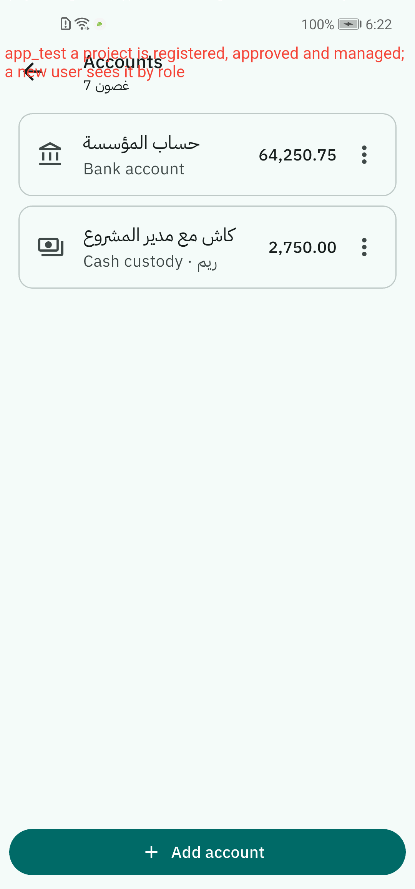
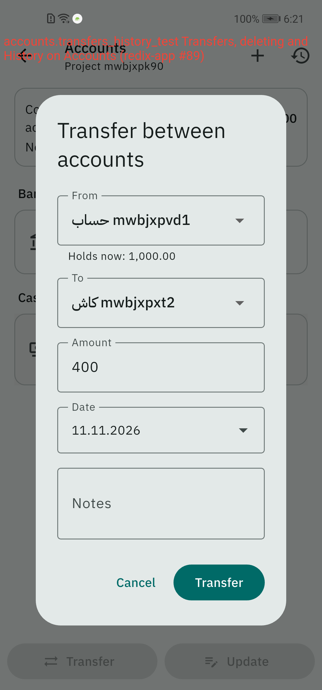
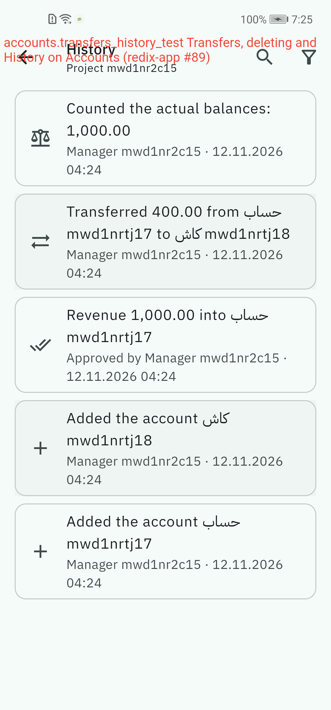
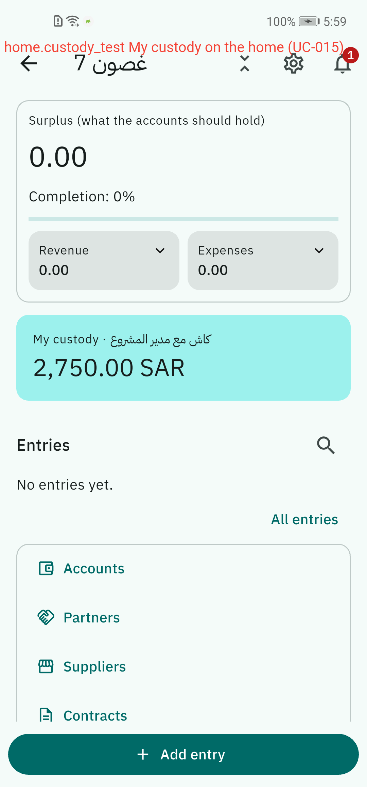

[Documentation](../README.md) › User guide › Accounts

# Accounts · الحسابات

    

## English

**What it is for:** where this project's money sits, its bank accounts and the cash each person holds, what each holds, and what was really counted in them.
**Who sees it:** everyone in the project, from **Accounts** on the project's home. It needs a network.

At the top: the surplus (revenue less expenses), the total of the actual balances counted at the last check, and the difference between them, red until it is zero. Under it, each account, banks first and then cash custodies: what it holds, and what was counted in it at the last check.

An account holds only what its approved entries and its transfers moved into it, less what they took out. It has no opening balance: money already in an account when the project starts is entered as capital in. If you hold a custody, the project's home shows what it holds.

| To | Do this | Who |
| --- | --- | --- |
| Move money between two accounts | Tap **Transfer** at the bottom, choose **From** and **To**, type the amount. It counts at once in both accounts and never in the surplus. You cannot move more than **From** holds. | Whoever moves money |
| Type what the accounts really hold | Tap **Update** at the bottom, beside Transfer, and type each account's balance. The difference at the top follows. | Whoever moves money |
| See what was done | Tap **History** at the top: every account added, changed, disabled or deleted, every transfer, every approved entry and every check, with who and when. Filter by one account, or by **What I did**. | Everyone in the project |
| Add an account | Tap **+** at the top, choose **Bank account** or **Cash custody**, type its name and choose who holds it. A cash custody must have someone. The type cannot change later. | Whoever does the project's finance |
| Change an account | Tap the three dots on its row, then **Edit account**: its name and who holds it. | Whoever does the project's finance |
| Stop using an account | Tap the three dots, then **Disable**: it leaves entry and every account list, and stays in the reports. **Enable** brings it back. | Whoever does the project's finance |
| Delete an account | Tap the three dots, then **Delete**. Once an entry, a check or a transfer names it, Delete stays gray and says why: disable it instead. | Whoever does the project's finance |

**An entry its account does not cover:** nothing blocks it. The approval inbox says how much the account holds, how much waits to leave it, and by how much it is short; a transfer of that amount takes the note away. A shared entry says only that the account does not hold enough.

| Message | Meaning |
| --- | --- |
| Enter a name of 1 to 100 characters. | The name is empty or too long. |
| A cash custody needs someone who holds it. | Choose who holds it. |
| That person is not in this project. | They left the project; choose someone else. |
| That is more than the account holds now. | Transfer at most what **From** holds. |
| Type an amount above zero. | The transfer's amount is empty, zero or not a number. |
| Used by entries, checks or transfers, so it can only be disabled. | Something names the account. |
| This project is finished, so nothing in it changes. | It was closed; you can still read this screen. |

## العربية

**الغرض:** أين تُحفظ أموال هذا المشروع: حساباته البنكية والنقد الذي بيد كل شخص، ورصيد كل منها، وما عُدّ فيها فعلاً.
**من يراها:** كل من في المشروع، من **الحسابات** في رئيسية المشروع. تحتاج إلى اتصال بالشبكة.

في الأعلى: الفائض (الإيرادات ناقص المصروفات)، ومجموع الأرصدة الفعلية في آخر مطابقة، والفرق بينهما، أحمر حتى يصير صفراً. وتحته كل حساب، البنكية أولاً ثم العهد النقدية: رصيده، وما عُدّ فيه في آخر مطابقة.

لا يحمل الحساب إلا ما أدخلته فيه قيوده المعتمدة وتحويلاته، ناقص ما أخرجته. ولا رصيد افتتاحي له: والمال الموجود في حساب عند بدء المشروع يُدخل رأس مال. وإن كانت لديك عهدة، تعرض رئيسية المشروع رصيدها.

| لكي | افعل هذا | من |
| --- | --- | --- |
| تنقل مالاً بين حسابين | اضغط **تحويل** في الأسفل، واختر **من** و**إلى**، واكتب المبلغ. يُحسب في الحسابين فوراً ولا يدخل في الفائض. ولا يُحوَّل أكثر من رصيد **من**. | من ينقل المال |
| تكتب ما في الحسابات فعلاً | اضغط **تحديث** في الأسفل بجانب تحويل، واكتب رصيد كل حساب. ويتبعه الفرق في الأعلى. | من ينقل المال |
| ترى ما جرى | اضغط **السجل** في الأعلى: كل حساب أُضيف أو عُدّل أو عُطّل أو حُذف، وكل تحويل، وكل قيد اعتُمد، وكل مطابقة، مع من فعلها ومتى. ويُصفّى بحساب واحد أو بـ **ما قمت به**. | كل من في المشروع |
| تضيف حساباً | اضغط **+** في الأعلى، واختر **حساب بنكي** أو **عهدة نقدية**، واكتب اسمه، واختر صاحب العهدة. والعهدة النقدية لا بد لها من صاحب. ولا يتغير النوع بعد ذلك. | من يتولى مالية المشروع |
| تغيّر حساباً | اضغط النقاط الثلاث في صفه، ثم **تعديل الحساب**: اسمه وصاحب عهدته. | من يتولى مالية المشروع |
| توقف استخدام حساب | اضغط النقاط الثلاث، ثم **تعطيل**: يخرج من الإدخال ومن كل قائمة حسابات، ويبقى في التقارير. و**تفعيل** يعيده. | من يتولى مالية المشروع |
| تحذف حساباً | اضغط النقاط الثلاث، ثم **حذف**. فإن ذكره قيد أو مطابقة أو تحويل بقي الحذف رمادياً وقال السبب: فعطّله بدلاً من ذلك. | من يتولى مالية المشروع |

**قيد لا يغطيه رصيد حسابه:** لا يمنعه شيء. ويذكر صندوق الاعتمادات رصيد الحساب، وما ينتظر الخروج منه، وكم ينقص؛ وتحويل بهذا المبلغ يزيل التنبيه. ولا يذكر القيد المرسل إلا أن رصيد الحساب لا يكفي.

| الرسالة | معناها |
| --- | --- |
| أدخل اسماً من 1 إلى 100 حرف. | الاسم فارغ أو طويل جداً. |
| العهدة النقدية تحتاج إلى صاحب عهدة. | اختر صاحب العهدة. |
| هذا الشخص ليس في هذا المشروع. | غادر المشروع، فاختر غيره. |
| المبلغ أكبر من رصيد الحساب الآن. | حوّل ما لا يزيد على رصيد **من**. |
| اكتب مبلغا أكبر من صفر. | مبلغ التحويل فارغ أو صفر أو ليس رقماً. |
| مستخدم في قيود أو مطابقات أو تحويلات، فيمكن تعطيله فقط. | شيء ما يذكر الحساب. |
| هذا المشروع منتهٍ، فلا يتغير فيه شيء. | أُغلق المشروع، وتبقى هذه الشاشة للقراءة. |
