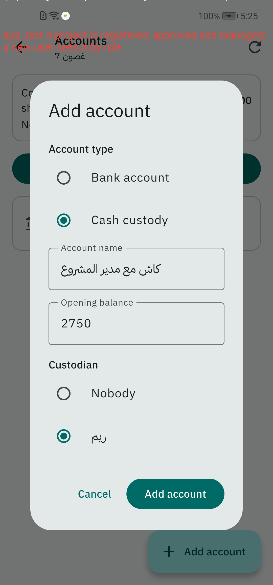

[Documentation](../README.md) › User guide › Accounts

# Accounts · الحسابات

  

## English

**What it is for:** where this project's money sits: its bank accounts and the cash each person holds.
**Who sees it:** everyone in the project, from **Accounts** on the project's home. Only whoever does the project's finance can change it. It needs a network.

If you hold a custody, the project's home shows what it holds. You spend only from what you hold.

| To | Do this |
| --- | --- |
| Add an account | Tap **Add account**, choose **Bank account** or **Cash custody**, type its name and opening balance, and choose who holds it. A cash custody must have someone. The type cannot change later. |
| Change an account | Tap the three dots on its row, then **Edit account**. |
| Stop using an account | Tap the three dots, then **Disable**: it disappears from entry and stays in the reports. **Enable** brings it back. Nothing is ever deleted. |

An opening balance may be negative, for an account that starts overdrawn. It shows in brackets: (120.40).

| Message | Meaning |
| --- | --- |
| Enter a name of 1 to 100 characters. | The name is empty or too long. |
| Enter an opening balance in numbers, with at most two decimals. | The opening balance is not a number. |
| A cash custody needs someone who holds it. | Choose who holds it. |
| That person is not in this project. | They left the project; choose someone else. |
| This project is finished, so nothing in it changes. | It was closed; you can still read this screen. |

## العربية

**الغرض:** أين تُحفظ أموال هذا المشروع: حساباته البنكية والنقد الذي بيد كل شخص.
**من يراها:** كل من في المشروع، من **الحسابات** في رئيسية المشروع. ولا يغيّرها إلا من يتولى مالية المشروع. تحتاج إلى اتصال بالشبكة.

إن كانت لديك عهدة، تعرض رئيسية المشروع رصيدها. ولا تصرف إلا مما بيدك.

| لكي | افعل هذا |
| --- | --- |
| تضيف حساباً | اضغط **إضافة حساب**، واختر **حساب بنكي** أو **عهدة نقدية**، واكتب اسمه ورصيده الافتتاحي، واختر صاحب العهدة. والعهدة النقدية لا بد لها من صاحب. ولا يتغير النوع بعد ذلك. |
| تغيّر حساباً | اضغط النقاط الثلاث في صفه، ثم **تعديل الحساب**. |
| توقف استخدام حساب | اضغط النقاط الثلاث، ثم **تعطيل**: يختفي من الإدخال ويبقى في التقارير. و**تفعيل** يعيده. ولا يُحذف شيء أبداً. |

يمكن أن يكون الرصيد الافتتاحي سالباً، لحساب يبدأ مكشوفاً. ويظهر بين قوسين: (120.40).

| الرسالة | معناها |
| --- | --- |
| أدخل اسماً من 1 إلى 100 حرف. | الاسم فارغ أو طويل جداً. |
| أدخل الرصيد الافتتاحي بالأرقام، بخانتين عشريتين على الأكثر. | ما كُتب ليس رقماً. |
| العهدة النقدية تحتاج إلى صاحب عهدة. | اختر صاحب العهدة. |
| هذا الشخص ليس في هذا المشروع. | غادر المشروع، فاختر غيره. |
| هذا المشروع منتهٍ، فلا يتغير فيه شيء. | أُغلق المشروع، وتبقى هذه الشاشة للقراءة. |
