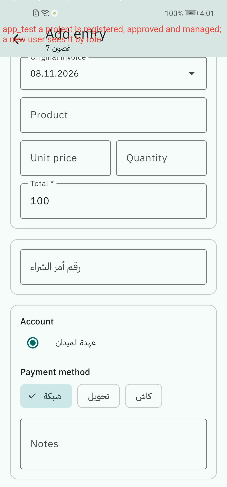

[Documentation](../README.md) › User guide › Add an entry

# Add an entry · إضافة قيد

   

## English

**What it is for:** recording what was paid into one table of an item's sheet: a purchase, its total on its date, or a [contractor payment](contractor-payment.md) when you choose a contract's table.
**Who sees it:** whoever enters expenses in the project, from **إضافة قيد** at the bottom of the project's home, while the project runs; anyone else sees the button gray. Without a network the entry waits on the phone and is sent when the network returns ([Waiting to sync](waiting-to-sync.md)).

| To | Do this |
| --- | --- |
| Photograph the invoice | The camera opens by itself. Line up the invoice and take it; it is cropped and made smaller for you. **Take again** replaces it. The picture is optional. |
| Use a file instead | Tap **Pick from files** for a picture or a PDF. |
| Choose the item | Tap **Item**, and type in its search to find an item or a contractor. Each item shows by its category, with its named tables and its contracts under it. An item's own table, or a named one, takes a purchase; a contract's takes a [contractor payment](contractor-payment.md). |
| Fill from the QR code | If the picture holds the e-invoice's QR code, the date and the total fill in, and the supplier with that VAT number is chosen. Check them. |
| Enter the total | Type the total paid, or leave it empty and type the unit price and quantity. |
| Record a credit note | Turn on **Credit note**, type the amount as printed, and choose the **Original invoice** it returns; the list says what each has left to return. |
| Take something off | Type the amount with a minus sign, such as -136, and say why in the notes. It comes off the item. |
| Choose how it was paid | Choose the account and the payment method. You see only the accounts you may pay from. |
| Keep it for later | Tap **Save draft**. A draft can wait for the required fields. |
| Send it | Tap **Send for approval**. It needs every field marked with *; the invoice's picture can be added later. |

No VAT is entered or kept: the VAT statement works it out of each total when the accountant takes it.

| Message | Meaning |
| --- | --- |
| A negative amount is a deduction: say why in the notes. | The amount is negative and the notes are empty. |
| Choose the bill this credit note returns. | **Credit note** is on and no original invoice is chosen. |
| A credit note cannot go above what is left of its original invoice. | Lower the amount, or choose another invoice. |
| Fill the required field. | A field marked with * is empty, and is marked in red. |
| Choose an account you may pay from. | No account was chosen, or you do not hold it. |
| You hold no account to pay from. Ask Finance to hand you one. | You hold no account in this project. |
| The date must be within the project's period and not in the future. | The date is before the project started, or after today. |
| No QR code could be read from this invoice. Fill the fields yourself. | The picture holds no QR code the phone can read. Your picture is still kept. |

## العربية

**الغرض:** تسجيل ما دُفع في جدول من جداول البند: عملية شراء بإجماليها في تاريخها، أو [دفعة مقاول](contractor-payment.md) حين تختار جدول عقد.
**من يراها:** من يُدخل المصروفات في المشروع، من **إضافة قيد** أسفل رئيسية المشروع، ما دام المشروع جارياً؛ ويراه غيره رمادياً. وبلا شبكة ينتظر القيد في الجوال ويُرسل حين تعود الشبكة ([بانتظار المزامنة](waiting-to-sync.md)).

| لكي | افعل هذا |
| --- | --- |
| تصوّر الفاتورة | تفتح الكاميرا من تلقاء نفسها. وجّهها إلى الفاتورة والتقطها، فتُقص وتُصغَّر تلقائياً. **إعادة التصوير** تستبدلها. والصورة اختيارية. |
| تستخدم ملفاً بدلاً منها | اضغط **اختيار من الملفات** لصورة أو ملف PDF. |
| تختار البند | اضغط **البند**، واكتب في بحثه لتجد بنداً أو مقاولاً. يظهر كل بند تحت تصنيفه، وتحته جداوله المسماة وعقوده. جدول البند نفسه أو جدول مسمى يأخذ عملية شراء، وجدول العقد يأخذ [دفعة مقاول](contractor-payment.md). |
| تعبّئ من رمز QR | إن كانت الصورة تحوي رمز QR للفاتورة الإلكترونية، يُعبَّأ التاريخ والإجمالي، ويُختار المورد صاحب الرقم الضريبي. راجعها. |
| تُدخل الإجمالي | اكتب الإجمالي المدفوع، أو اتركه فارغاً واكتب سعر الوحدة والعدد. |
| تسجّل مرتجعاً | فعّل **مرتجع (إشعار دائن)**، واكتب المبلغ كما هو مكتوب، واختر **الفاتورة الأصلية** التي يرجعها؛ وتبيّن القائمة المتبقي للإرجاع من كل فاتورة. |
| تخصم مبلغاً | اكتب المبلغ بعلامة الناقص، مثل -136، واذكر السبب في الملاحظات. يُخصم من البند. |
| تحدد طريقة الدفع | اختر الحساب وطريقة الدفع. لا ترى إلا الحسابات التي يحق لك الدفع منها. |
| تحفظه لوقت لاحق | اضغط **حفظ مسودة**. يمكن للمسودة أن تنتظر الحقول الإلزامية. |
| ترسله | اضغط **إرسال للاعتماد**. يحتاج إلى كل حقل عليه علامة *، ويمكن إضافة صورة الفاتورة لاحقاً. |

لا تُدخل الضريبة ولا تُحفظ: يحسبها كشف الضريبة من كل إجمالي حين يأخذه المحاسب.

| الرسالة | معناها |
| --- | --- |
| المبلغ السالب خصم: اذكر سببه في الملاحظات. | المبلغ سالب والملاحظات فارغة. |
| اختر الفاتورة التي يرجعها هذا المرتجع. | خيار **مرتجع** مفعّل ولم تُختر الفاتورة الأصلية. |
| لا يمكن أن يتجاوز المرتجع المتبقي من فاتورته الأصلية. | اخفض المبلغ، أو اختر فاتورة أخرى. |
| عبّئ الحقل الإلزامي. | حقل عليه علامة * فارغ، ويظهر بالأحمر. |
| اختر حساباً يحق لك الدفع منه. | لم تختر حساباً، أو أنه ليس بعهدتك. |
| لا تملك حساباً تدفع منه. اطلب من المالي تسليمك حساباً. | لا تملك أي حساب في هذا المشروع. |
| يجب أن يقع التاريخ ضمن فترة المشروع وألا يكون في المستقبل. | التاريخ قبل بدء المشروع، أو بعد اليوم. |
| تعذّرت قراءة رمز QR من هذه الفاتورة. عبّئ الحقول يدوياً. | الصورة لا تحوي رمزاً يقرؤه الجهاز. وتبقى صورتك محفوظة. |
