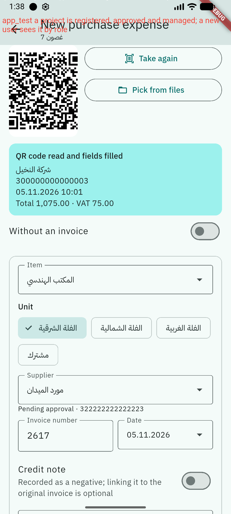
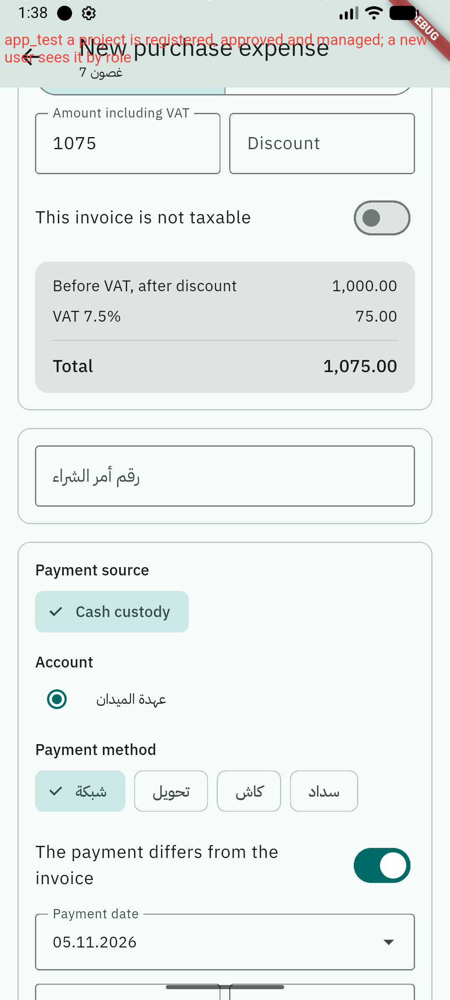
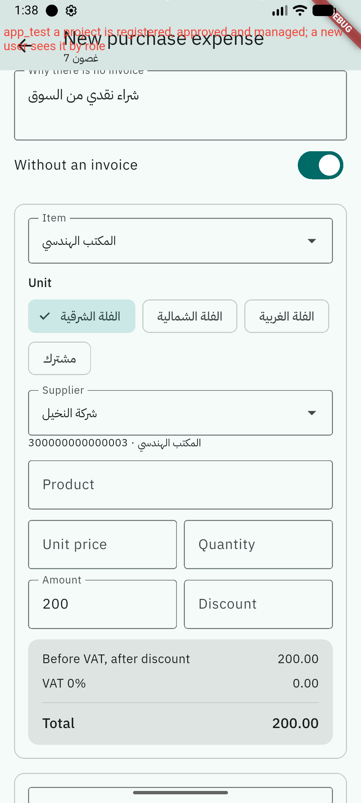

[Documentation](../README.md) › User guide › New purchase expense

# New purchase expense · مصروف شراء جديد

    

## English

**What it is for:** recording a purchase with its invoice, so the amounts are computed as the accountant computes them.
**Who sees it:** whoever enters expenses in the project, from **New purchase expense** on the project's home, while the project runs. It needs a network.

| To | Do this |
| --- | --- |
| Photograph the invoice | The camera opens by itself. Line up the invoice and take it; it is cropped and made smaller for you. **Take again** replaces it. |
| Use a file instead | Tap **Pick from files** for a picture or a PDF. |
| Fill from the QR code | If the picture holds the e-invoice's QR code, the seller, VAT number, date and amount fill in, and the supplier with that number is chosen. Check them. |
| Record an expense with no invoice | Turn on **Without an invoice** and say why. The invoice's fields leave the form; enter the amount and the payment date. It has no VAT, and Finance sees it among the exceptions. |
| Record a credit note | Turn on **Credit note**, enter its own number and date, and the amount as printed. The figures show negative. Link it to the original invoice if you like; the list says what each has left to return. |
| Take something off | Turn on **Without an invoice**, say why, and type the amount with a minus sign, such as -136. It comes off the item. |
| Enter the amount | Choose **Including VAT** or **Before VAT** and type the amount, or leave it empty and type the unit price and quantity. A unit price always includes VAT. The amounts below follow as you type. |
| Say the invoice has no VAT | Turn on **This invoice is not taxable**. A supplier not VAT-registered has no VAT by itself. |
| Choose how it was paid | Choose the source, the account and the payment method. You see only the accounts you may pay from. |
| Record a payment that differs from the invoice | Turn on **The payment differs from the invoice**, then enter its date, amount and any bank fees. |
| Keep it for later | Tap **Save draft**. A draft can wait for the invoice and the required fields. |
| Send it | Tap **Send for approval**. It needs the invoice's picture or PDF, and every field marked with *. |

The figures saved are computed by the server from what you typed, and kept with four decimals, so a total matches the accountant's. They show here with two.

If the same supplier and invoice number were already entered, you see the earlier entry and choose. Save anyway only if this is a different invoice.

| Message | Meaning |
| --- | --- |
| This invoice looks entered already | The same supplier and number exist; see above. |
| Add the invoice's picture or PDF before sending. | Sending needs the invoice, or **Without an invoice** with the reason. |
| Say why there is no invoice, in up to 500 characters. | **Without an invoice** is on and the reason is empty. |
| A credit note cannot go above what is left of its original invoice. | Lower the amount, or link another invoice. |
| A negative amount is a deduction with no invoice. Turn on Without an invoice and say why. | A negative amount with an invoice number; see above. |
| Fill the required field. | A field marked with * is empty, and is marked in red. |
| Choose an account you may pay from. | No account was chosen, or you do not hold it. |
| You hold no account to pay from. Ask Finance to hand you one. | You hold no account in this project. |
| The date must be within the project's period and not in the future. | The date is before the project started, or after today. |
| No QR code could be read from this invoice. Fill the fields yourself. | The picture holds no QR code the phone can read. Your picture is still kept. |
| The VAT on the invoice differs from the computed VAT by more than 0.01. You can still save. | Check the amount and the supplier against the invoice. |

## العربية

**الغرض:** تسجيل عملية شراء مع فاتورتها، لتُحسب المبالغ كما يحسبها المحاسب.
**من يراها:** من يُدخل المصروفات في المشروع، من **مصروف شراء جديد** في رئيسية المشروع، ما دام المشروع جارياً. تحتاج إلى اتصال بالشبكة.

| لكي | افعل هذا |
| --- | --- |
| تصوّر الفاتورة | تفتح الكاميرا من تلقاء نفسها. وجّهها إلى الفاتورة والتقطها، فتُقص وتُصغَّر تلقائياً. **إعادة التصوير** تستبدلها. |
| تستخدم ملفاً بدلاً منها | اضغط **اختيار من الملفات** لصورة أو ملف PDF. |
| تعبّئ من رمز QR | إن كانت الصورة تحوي رمز QR للفاتورة الإلكترونية، تُعبَّأ بيانات البائع والرقم الضريبي والتاريخ والمبلغ، ويُختار المورد صاحب الرقم. راجعها. |
| تسجّل مصروفاً بلا فاتورة | فعّل **بدون فاتورة** واذكر السبب. تختفي حقول الفاتورة؛ أدخل المبلغ وتاريخ الدفع. لا ضريبة عليه، ويراه المالي ضمن الاستثناءات. |
| تسجّل مرتجعاً | فعّل **مرتجع (إشعار دائن)**، وأدخل رقمه وتاريخه الخاصين، والمبلغ كما هو مكتوب. تظهر الأرقام بالسالب. اربطه بالفاتورة الأصلية إن شئت؛ وتبيّن القائمة المتبقي للإرجاع من كل فاتورة. |
| تخصم مبلغاً | فعّل **بدون فاتورة**، واذكر السبب، واكتب المبلغ بعلامة الناقص، مثل -136. يُخصم من البند. |
| تُدخل المبلغ | اختر **شامل الضريبة** أو **قبل الضريبة** واكتب المبلغ، أو اتركه فارغاً واكتب سعر الوحدة والعدد. سعر الوحدة شامل الضريبة دائماً. تتبعك المبالغ أسفله وأنت تكتب. |
| تذكر أن الفاتورة بلا ضريبة | فعّل **هذه الفاتورة غير خاضعة للضريبة**. أما المورد غير المسجل بالضريبة فلا ضريبة عليه تلقائياً. |
| تحدد طريقة الدفع | اختر المصدر والحساب وطريقة الدفع. لا ترى إلا الحسابات التي يحق لك الدفع منها. |
| تسجّل دفعة تختلف عن الفاتورة | فعّل **الدفع يختلف عن الفاتورة**، ثم أدخل تاريخها ومبلغها وأي رسوم بنكية. |
| تحفظه لوقت لاحق | اضغط **حفظ مسودة**. يمكن للمسودة أن تنتظر الفاتورة والحقول الإلزامية. |
| ترسله | اضغط **إرسال للاعتماد**. يحتاج إلى صورة الفاتورة أو ملف PDF، وإلى كل حقل عليه علامة *. |

يحسب الخادم الأرقام المحفوظة مما كتبته، ويحفظها بأربع خانات عشرية، ليطابق الإجمالي ما عند المحاسب. وتظهر هنا بخانتين.

إن كان نفس المورد ورقم الفاتورة مُدخلين من قبل، يظهر لك القيد السابق وتختار. احفظ رغم ذلك فقط إن كانت فاتورة مختلفة.

| الرسالة | معناها |
| --- | --- |
| يبدو أن هذه الفاتورة مُدخلة مسبقاً | نفس المورد والرقم موجودان؛ انظر أعلاه. |
| أضف صورة الفاتورة أو ملف PDF قبل الإرسال. | الإرسال يحتاج إلى الفاتورة، أو إلى **بدون فاتورة** مع السبب. |
| اذكر سبب عدم وجود فاتورة، حتى 500 حرف. | خيار **بدون فاتورة** مفعّل والسبب فارغ. |
| لا يمكن أن يتجاوز المرتجع المتبقي من فاتورته الأصلية. | اخفض المبلغ، أو اربطه بفاتورة أخرى. |
| المبلغ السالب خصم بلا فاتورة. فعّل بدون فاتورة واذكر السبب. | مبلغ سالب مع رقم فاتورة؛ انظر أعلاه. |
| عبّئ الحقل الإلزامي. | حقل عليه علامة * فارغ، ويظهر بالأحمر. |
| اختر حساباً يحق لك الدفع منه. | لم تختر حساباً، أو أنه ليس بعهدتك. |
| لا تملك حساباً تدفع منه. اطلب من المالي تسليمك حساباً. | لا تملك أي حساب في هذا المشروع. |
| يجب أن يقع التاريخ ضمن فترة المشروع وألا يتجاوز اليوم. | التاريخ قبل بدء المشروع، أو بعد اليوم. |
| تعذّرت قراءة رمز QR من هذه الفاتورة. عبّئ الحقول يدوياً. | الصورة لا تحوي رمزاً يقرؤه الجهاز. وتبقى صورتك محفوظة. |
| ضريبة الفاتورة تختلف عن الضريبة المحسوبة بأكثر من 0.01. يمكنك الحفظ رغم ذلك. | طابق المبلغ والمورد مع الفاتورة. |
