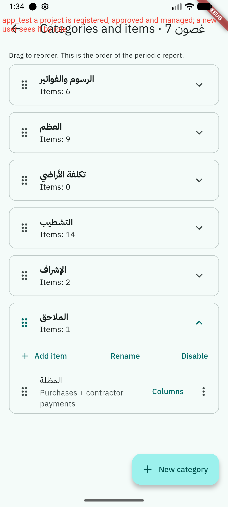
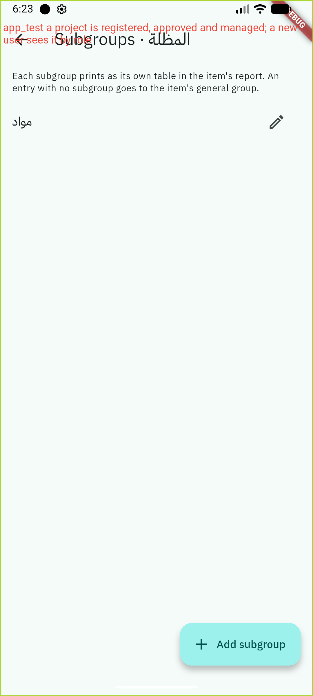

[Documentation](../README.md) › User guide › Categories and items

# Categories and items · التصنيفات والبنود

 

## English

**What it is for:** shaping what a project's expenses are recorded against, and the order the periodic report prints them in.
**Who sees it:** whoever does the project's finance, from **Categories and items** on the project's home. It needs a network.

A project starts with the categories and items of the default template, or of the earlier project chosen when it was registered. From then on they are this project's own: changing them touches no other project.

Tap a category to open it.

| To | Do this |
| --- | --- |
| Add a category | Tap **New category** and type its name. |
| Add an item | Open the category, tap **Add item**, type its name and choose its type. The type cannot change later. |
| Change the order | Drag the handle beside a category or an item. It is saved as you drop it, and it is the order of the periodic report. |
| Rename a category | Open it and tap **Rename**. |
| Rename an item | Tap the three dots on its row, then **Rename**. |
| Change what an item asks for | Tap **Columns** on its row. See [Item columns](item-columns.md). |
| Stop using something | Tap **Disable**: it disappears from entry and stays in the reports, and **Enable** brings it back. Nothing is ever deleted. |

An item's type says what it can be used for: **Purchases**, **Contractor payments**, or both. A purchases item is not offered when entering a contractor payment.

### Subgroups

A subgroup splits an item, as البلاط splits into مواد and دفان, and prints as its own table in the item's report. Tap the three dots on the item, then **Subgroups**. An entry with no subgroup goes to the item's general group, which needs nothing from you.

| Message | Meaning |
| --- | --- |
| Enter a name of 1 to 100 characters. | The name is empty or too long. |
| This project is finished, so nothing in it changes. | It was closed; you can still read its structure. |
| The list has changed. Try again. | Someone else changed the list while you dragged. |

## العربية

**الغرض:** تشكيل ما تُسجَّل عليه مصروفات المشروع، والترتيب الذي تُطبع به في التقرير الدوري.
**من يراها:** من يتولى مالية المشروع، من **التصنيفات والبنود** في الشاشة الرئيسية للمشروع. تحتاج إلى شبكة.

يبدأ المشروع بتصنيفات القالب الافتراضي وبنوده، أو بتصنيفات المشروع السابق الذي اختير عند تسجيله. وبعدها تصبح خاصة بهذا المشروع: تغييرها لا يمس أي مشروع آخر.

اضغط تصنيفاً لفتحه.

| لكي | افعل هذا |
| --- | --- |
| تضيف تصنيفاً | اضغط **تصنيف رئيسي جديد** واكتب اسمه. |
| تضيف بنداً | افتح التصنيف، واضغط **إضافة بند**، واكتب اسمه واختر نوعه. لا يتغير النوع لاحقاً. |
| تغيّر الترتيب | اسحب المقبض بجانب التصنيف أو البند. يُحفظ عند الإفلات، وهو ترتيب التقرير الدوري. |
| تعيد تسمية تصنيف | افتحه واضغط **إعادة تسمية**. |
| تعيد تسمية بند | اضغط النقاط الثلاث في صفه، ثم **إعادة تسمية**. |
| تغيّر ما يطلبه البند | اضغط **الأعمدة** في صفه. انظر [أعمدة البند](item-columns.md). |
| توقف استخدام شيء | اضغط **تعطيل**: يختفي من الإدخال ويبقى في التقارير، و**تفعيل** يعيده. لا يُحذف شيء أبداً. |

نوع البند يحدد ما يُستخدم له: **مشتريات**، أو **دفعات مقاولين**، أو الاثنان. بند المشتريات لا يظهر عند إدخال دفعة مقاول.

### المجموعات الفرعية

المجموعة الفرعية تقسم البند، كما ينقسم البلاط إلى مواد ودفان، وتُطبع جدولاً مستقلاً في تقرير البند. اضغط النقاط الثلاث في البند، ثم **المجموعات الفرعية**. والقيد بلا مجموعة يدخل في المجموعة العامة للبند، ولا تحتاج منك إلى شيء.

| الرسالة | معناها |
| --- | --- |
| أدخل اسماً من 1 إلى 100 حرف. | الاسم فارغ أو طويل جداً. |
| هذا المشروع منتهٍ، فلا يتغير فيه شيء. | أُغلق المشروع؛ ويمكنك قراءة تصنيفاته وبنوده. |
| تغيّرت القائمة. حاول مرة أخرى. | غيّر شخص آخر القائمة أثناء السحب. |
