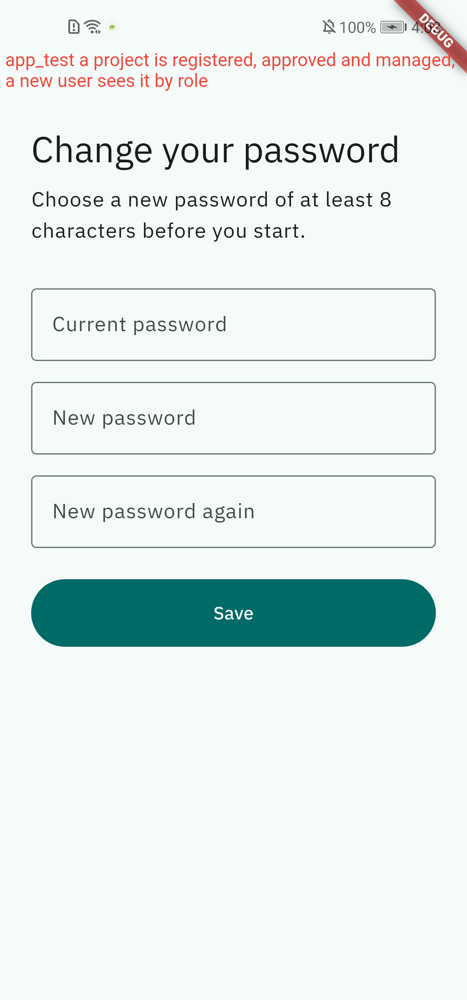

[Documentation](../README.md) › User guide › Change password

# Change password · تغيير كلمة المرور

## English

**What it is for:** choosing your own password. When the financial supervisor gives you a temporary one, the app opens this screen right after sign-in and lets you go nowhere else until you change it.
**Who sees it:** everyone signed in with a temporary password.

1. Type your current password, the temporary one.
2. Type a new password of at least 8 characters, different from the current one, then type it again.
3. Tap **Save**. You land on your [projects](projects.md).

Changing your password signs you out on your other phones; this phone stays signed in.

| Message | Meaning |
| --- | --- |
| The new passwords do not match. | The two new passwords differ; type them again. |
| The current password is wrong. | Check the password you signed in with. |
| Too many wrong tries. Try again later. | Five wrong passwords in a row lock the account for 15 minutes. |
| Use at least 8 characters, different from the current password. | Choose a longer or a different password. |
| No connection to the server. Try again. | The phone cannot reach REDIX; check the network. |

## العربية

**الغرض:** اختيار كلمة المرور الخاصة بك. عندما يعطيك المشرف المالي كلمة مرور مؤقتة، يفتح التطبيق هذه الشاشة بعد تسجيل الدخول مباشرة ولا يسمح بغيرها حتى تغيّرها.
**من يراها:** كل من سجّل الدخول بكلمة مرور مؤقتة.

1. اكتب كلمة المرور الحالية، أي المؤقتة.
2. اكتب كلمة مرور جديدة من 8 أحرف على الأقل، مختلفة عن الحالية، ثم أعد كتابتها.
3. اضغط **حفظ**، فتنتقل إلى [مشاريعك](projects.md).

تغيير كلمة المرور يسجّل خروجك من جوالاتك الأخرى، ويبقيك مسجّلاً على هذا الجوال.

| الرسالة | معناها |
| --- | --- |
| كلمتا المرور الجديدتان غير متطابقتين. | الكلمتان الجديدتان مختلفتان؛ أعد كتابتهما. |
| كلمة المرور الحالية غير صحيحة. | تحقق من كلمة المرور التي دخلت بها. |
| محاولات خاطئة كثيرة. حاول مرة أخرى لاحقاً. | خمس كلمات مرور خاطئة متتالية تقفل الحساب 15 دقيقة. |
| استخدم 8 أحرف على الأقل، مختلفة عن كلمة المرور الحالية. | اختر كلمة أطول أو مختلفة. |
| لا يوجد اتصال بالخادم. حاول مرة أخرى. | لا يصل الجوال إلى REDIX؛ تحقق من الشبكة. |
