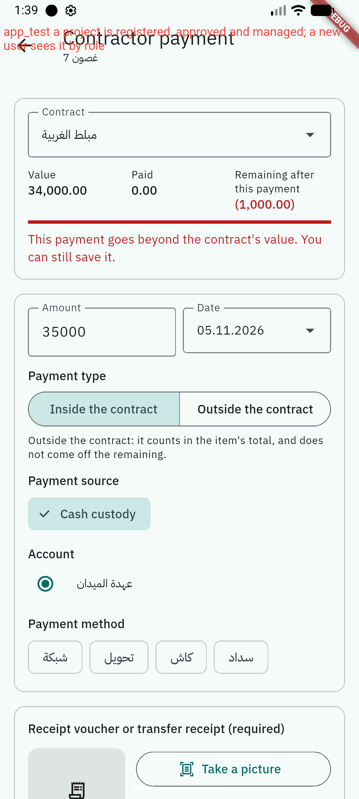
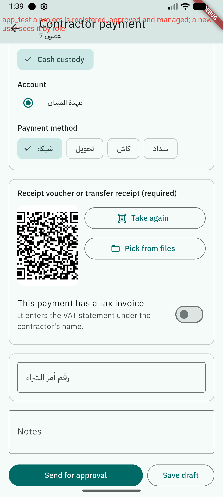

[Documentation](../README.md) › User guide › Contractor payment

# Contractor payment · دفعة مقاول

 

## English

**What it is for:** paying a contractor against a contract, and seeing what it leaves before you save.
**Who sees it:** whoever enters expenses in the project, from **Contractor payment** on the project's home, while the project runs. It needs a network.

| To | Do this |
| --- | --- |
| Choose the contract | Tap **Contract**. Its value, what was paid and what remains after this payment show. What waits for approval shows too, and counts in what remains. |
| Enter the payment | Type the amount and choose the date. |
| Say it is outside the contract | Choose **Outside the contract**. It counts in the item's total, and does not come off the remaining. |
| Take something off | Type the amount with a minus sign, such as -136, and say why. It comes off what was paid, and needs no receipt. |
| Choose how it was paid | Choose the source, the account and the payment method. You see only the accounts you may pay from. |
| Add the receipt | **Take photo** or **Pick from files**, for the receipt voucher or the transfer receipt. |
| Add a tax invoice | Turn on **This payment has a tax invoice**, and enter its number, date and amount before VAT. The VAT is computed for you, and it enters the VAT statement under the contractor's name. |
| Keep it for later | Tap **Save draft**. A draft can wait for the receipt. |
| Send it | Tap **Send for approval**. It needs the receipt. |

What was paid counts only once approved; until then a payment shows as waiting for approval.

| Message | Meaning |
| --- | --- |
| This payment goes beyond the contract's value. You can still save it. | What remains goes below zero. Check it; saving still works. |
| Add the transfer receipt or the receipt voucher before sending. | Sending needs the receipt. |
| Say why it is deducted. | The amount is negative and the reason is empty. |
| Choose a contract. | No contract was chosen. |

## العربية

**الغرض:** الدفع لمقاول على عقد، ورؤية ما يبقى قبل الحفظ.
**من يراها:** من يُدخل المصروفات في المشروع، من **دفعة مقاول** في رئيسية المشروع، ما دام المشروع قائماً. تحتاج إلى اتصال بالشبكة.

| لكي | افعل هذا |
| --- | --- |
| تختار العقد | اضغط **العقد**. تظهر قيمته والمدفوع والمتبقي بعد هذه الدفعة. ويظهر أيضاً ما ينتظر الاعتماد، ويدخل في حساب المتبقي. |
| تُدخل الدفعة | اكتب المبلغ واختر التاريخ. |
| تذكر أنها خارج العقد | اختر **خارج العقد**. تدخل إجمالي البند ولا تُخصم من المتبقي. |
| تخصم مبلغاً | اكتب المبلغ بعلامة الناقص، مثل -136، واذكر السبب. يُخصم من المدفوع، ولا يحتاج إلى إيصال. |
| تحدد طريقة الدفع | اختر المصدر والحساب وطريقة الدفع. لا ترى إلا الحسابات التي يحق لك الدفع منها. |
| تضيف الإيصال | **تصوير** أو **من الملفات**، لسند الاستلام أو إيصال التحويل. |
| تضيف فاتورة ضريبية | فعّل **للدفعة فاتورة ضريبية**، وأدخل رقمها وتاريخها ومبلغها قبل الضريبة. تُحسب الضريبة تلقائياً، وتدخل كشف الضريبة باسم المقاول. |
| تحفظها لوقت لاحق | اضغط **حفظ مسودة**. يمكن للمسودة أن تنتظر الإيصال. |
| ترسلها | اضغط **إرسال للاعتماد**. تحتاج إلى الإيصال. |

لا يُحسب المدفوع إلا بعد الاعتماد؛ وحتى ذلك الحين تظهر الدفعة بانتظار الاعتماد.

| الرسالة | معناها |
| --- | --- |
| هذه الدفعة تتجاوز قيمة العقد. يمكنك الحفظ رغم ذلك. | المتبقي ينزل تحت الصفر. تأكد منها؛ والحفظ ما زال ممكناً. |
| أضف إيصال التحويل أو سند الاستلام قبل الإرسال. | الإرسال يحتاج إلى الإيصال. |
| اذكر سبب الخصم. | المبلغ سالب والسبب فارغ. |
| اختر عقداً. | لم تختر عقداً. |
