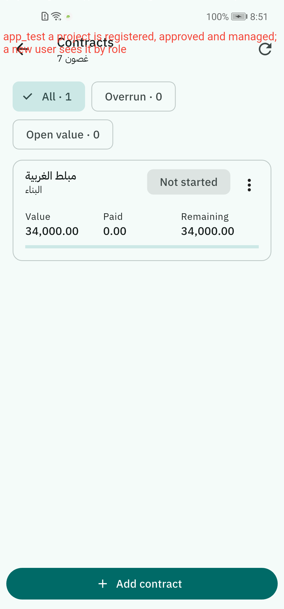
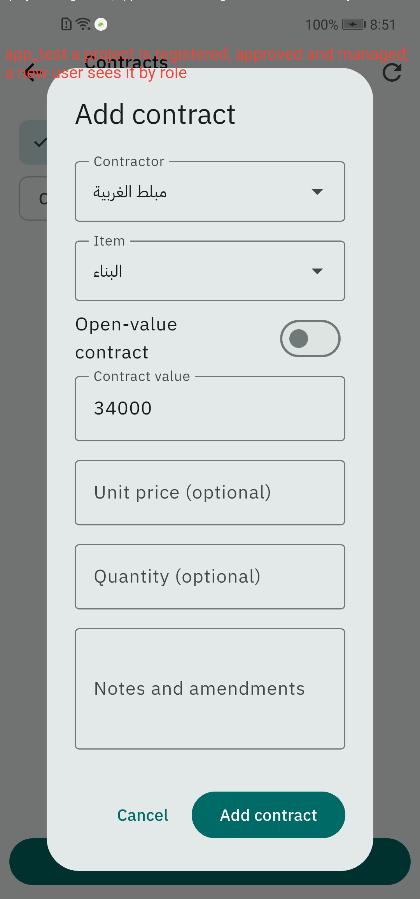

[Documentation](../README.md) › User guide › Contracts

# Contracts · العقود

 

## English

**What it is for:** what each contractor was promised, what was paid inside the contract, and what remains.
**Who sees it:** everyone in the project, from **Contracts** on the project's home. Only whoever does the finance can change it. It needs a network.

What was paid counts only once approved. What waits shows under the figures as **Waiting for approval**. Payments are entered on the [Contractor payment](contractor-payment.md) screen.

| To | Do this |
| --- | --- |
| Add a contract | Tap **Add contract**, choose the contractor and the item, and type the value. Unit price, quantity and notes are optional. |
| Add a contract with no fixed value | Turn on **Open-value contract**. Its payments only add up, with nothing remaining and no alert. |
| See only some contracts | Tap **Overrun** or **Open value** above the list; **All** shows them all again. |
| Change the value, the notes or an amendment | Open the menu on its card and tap **Amend contract**. Every change is recorded with who made it. |
| Keep the contract's document | In the dialog, tap **Add a document** and pick a picture or a PDF. It is kept when you save, and stays once attached. It cannot be opened from the app yet. |
| Stop using a contract | Open the menu on its card and tap **Disable**. It stays on the list, and nothing is ever deleted. |
| See a contract's payments | Tap its card. Its own table opens: each payment, its total, and the value, paid and remaining. It needs **See reports**. |
| Take a contract's PDF or Excel | Open the menu on its card and tap **PDF** or **Excel**, then save or share it. They need **Generate reports**: without it they show gray, saying so. |

The contractor and item can change from **Edit** while the contract has no payments. Once one exists they stay, so if one is wrong, disable the contract and add it again.

A contractor comes from the project's suppliers. If yours is missing, tap **New supplier** while choosing. An item shows here only if it takes contractor payments. A contract belongs to the project, not a unit.

A remaining in red and brackets, such as (1,000.00), means more was paid than was promised.

| Message | Meaning |
| --- | --- |
| Choose a contractor from the suppliers. | No contractor was chosen, or it was disabled. |
| Choose an item that takes contractor payments. | No item was chosen, or it was disabled. |
| Enter a contract value above zero, with at most two decimals. | The value is empty, zero or not a number. |
| This project is finished, so nothing in it changes. | It was closed; you can still read this screen. |

## العربية

**الغرض:** ما وُعد به كل مقاول، وما دُفع داخل العقد، وما تبقى منه.
**من يراها:** كل من في المشروع، من **العقود** في رئيسية المشروع. ولا يغيّرها إلا من يتولى المالية. تحتاج إلى اتصال بالشبكة.

| لكي | افعل هذا |
| --- | --- |
| تضيف عقداً | اضغط **إضافة عقد**، واختر المقاول والبند، واكتب القيمة. وسعر الوحدة والكمية والملاحظات اختيارية. |
| تضيف عقداً بلا قيمة محددة | فعّل **عقد مفتوح القيمة**. فتُجمع دفعاته فقط، بلا متبقٍ ولا تنبيه. |
| تعرض بعض العقود فقط | اضغط **متجاوز** أو **مفتوح القيمة** فوق القائمة، و**الكل** تعيدها كلها. |
| تغيّر القيمة أو الملاحظات أو تسجل تعديلاً | افتح القائمة في بطاقته واضغط **تعديل العقد**. ويُسجَّل كل تغيير باسم من قام به. |
| تحفظ مستند العقد | في النافذة، اضغط **إضافة مستند** واختر صورة أو ملف PDF. يُحفظ عند الحفظ، ويبقى بعد إرفاقه. لا يمكن فتحه من التطبيق حالياً. |
| توقف استخدام عقد | افتح القائمة في بطاقته واضغط **تعطيل**. يبقى في القائمة، ولا يُحذف شيء أبداً. |
| ترى دفعات عقد | اضغط بطاقته. يُفتح جدوله: كل دفعة، ومجموعها، والقيمة والمدفوع والمتبقي. ويحتاج **يرى التقارير**. |
| تأخذ ملف PDF أو Excel لعقد | افتح القائمة في بطاقته واضغط **PDF** أو **Excel**، ثم احفظه أو شاركه. ويحتاجان **يُصدر التقارير**: فمن لا يملكها يراهما رماديين مع السبب. |

يمكن تغيير المقاول والبند من **تعديل** ما دام العقد بلا دفعات. فإذا وُجدت دفعة بقيت كما هي، فإن كان أحدها خطأً فعطّل العقد وأضفه من جديد.

يأتي المقاول من موردي المشروع. فإن لم تجده فاضغط **مورد جديد** أثناء الاختيار. ولا يظهر هنا من البنود إلا ما يقبل دفعات المقاولين. والعقد للمشروع لا لوحدة.

المتبقي بالأحمر بين قوسين، مثل (1,000.00)، يعني أن المدفوع تجاوز قيمة العقد.

| الرسالة | معناها |
| --- | --- |
| اختر مقاولاً من الموردين. | لم يُختر مقاول، أو عُطّل. |
| اختر بنداً يقبل دفعات المقاولين. | لم يُختر بند، أو عُطّل. |
| أدخل قيمة عقد أكبر من صفر، بخانتين عشريتين على الأكثر. | القيمة فارغة أو صفر أو ليست رقماً. |
| هذا المشروع منتهٍ، فلا يتغير فيه شيء. | أُغلق المشروع، وتبقى هذه الشاشة للقراءة. |
