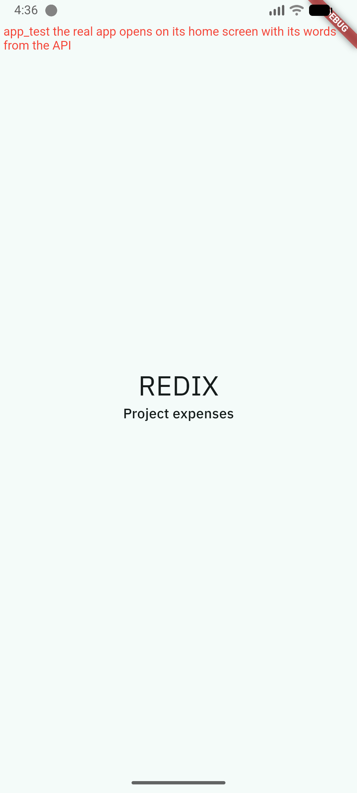

[Documentation](../README.md) › User guide › Home

# Home · الرئيسية

## English

**What it is for:** the screen REDIX opens on. Today it shows the app's name and what it is for; from sign-in on, it leads to your projects.
**Who sees it:** everyone.

The app speaks your phone's language: Arabic right to left, English left to right. On a phone in any other language it speaks Arabic.

If the very first start has no network, the app shows a no-network icon and a retry button. Connect, then tap retry.

## العربية

**الغرض:** الشاشة التي يفتح عليها REDIX. تعرض حالياً اسم التطبيق والغرض منه، وبعد تسجيل الدخول تقودك إلى مشاريعك.
**من يراها:** الجميع.

يتحدث التطبيق بلغة جوالك: العربية من اليمين لليسار، والإنجليزية من اليسار لليمين. وإذا كان جوالك بلغة أخرى فيتحدث العربية.

إذا لم تتوفر شبكة عند أول تشغيل، تظهر أيقونة انقطاع الشبكة وزر إعادة المحاولة. اتصل بالشبكة ثم اضغط إعادة المحاولة.
