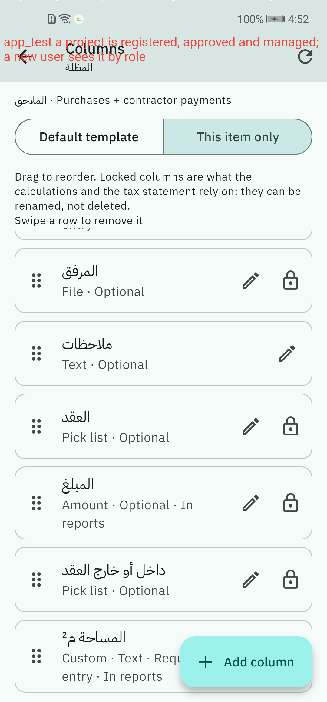
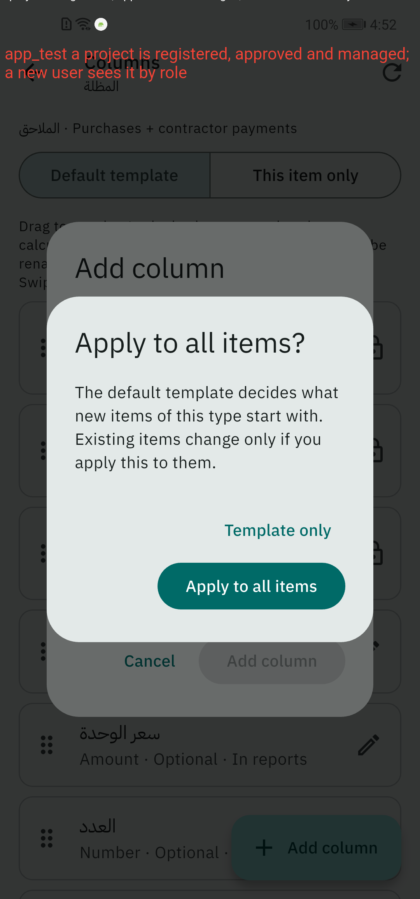

[Documentation](../README.md) › User guide › Item columns

# Item columns · أعمدة البند

 

## English

**What it is for:** changing what an item asks for when an expense is entered, and what its table prints in the reports, without any change to the app.
**Who sees it:** whoever does the project's finance, from **Columns** on an item in [Categories and items](categories.md). It needs a network.

At the top, choose what you are changing.

| Choice | Changes |
| --- | --- |
| This item only | This item, and nothing else. |
| Default template | What new items of this type start with. After each change the app asks whether items that already exist follow it: **Apply to all items**, or **Template only**. |

Each project has its own default template: changing it touches no other project.

| To | Do this |
| --- | --- |
| Add a column | Tap **Add column**. Type its name, choose its type, and say whether entry requires it and whether it prints in reports. For a pick list, type the choices, one on each line. The type cannot change later. |
| Change a column | Tap the pencil on its row. A pick list you added can gain choices; those it has stay, because entries hold them. |
| Change the order | Drag the handle on its row. It is saved as you drop it. |
| Delete a column | Swipe its row from its end toward its start (right to left in English, left to right in Arabic). It leaves entry with no question, and values already recorded stay on their entries and in the audit trail. |

A **lock** marks a core column: the calculations and the tax statement rely on it, so it can be renamed and moved, but not deleted, and it stays required or optional as it is.

| Message | Meaning |
| --- | --- |
| Enter a name of 1 to 100 characters. | The name is empty or too long. |
| Enter at least one choice, of up to 100 characters each. | A pick list needs a choice. |
| A core column cannot be deleted, and only its name changes. | Someone tried more than renaming a locked column. |
| This project is finished, so nothing in it changes. | It was closed; you can still read its columns. |

## العربية

**الغرض:** تغيير ما يطلبه البند عند إدخال مصروف، وما يطبعه جدوله في التقارير، دون أي تغيير في التطبيق.
**من يراها:** من يتولى مالية المشروع، من **الأعمدة** على البند في [التصنيفات والبنود](categories.md). تحتاج إلى شبكة.

اختر في الأعلى ما تريد تغييره.

| الخيار | ما يغيّره |
| --- | --- |
| هذا البند فقط | هذا البند، ولا شيء غيره. |
| القالب الافتراضي | ما تبدأ به البنود الجديدة من هذا النوع. وبعد كل تغيير يسأل التطبيق هل تتبعه البنود الموجودة: **تطبيق على كل البنود**، أو **القالب فقط**. |

لكل مشروع قالبه الافتراضي: تغييره لا يمس أي مشروع آخر.

| لكي | افعل هذا |
| --- | --- |
| تضيف عموداً | اضغط **إضافة عمود**. اكتب اسمه، واختر نوعه، وحدد هل هو إلزامي عند الإدخال وهل يظهر في التقارير. وفي قائمة الاختيار اكتب الخيارات، كل خيار في سطر. لا يتغير النوع لاحقاً. |
| تغيّر عموداً | اضغط القلم في صفه. ويمكن أن تكسب قائمة الاختيار التي أضفتها خيارات جديدة؛ وتبقى خياراتها لأن القيود تحملها. |
| تغيّر الترتيب | اسحب المقبض في صفه. يُحفظ عند الإفلات. |
| تحذف عموداً | اسحب سطره من نهايته نحو بدايته (من اليسار إلى اليمين بالعربية)، فيُحذف دون سؤال. يختفي من الإدخال، وتبقى قيمه المسجلة في القيود السابقة وسجل التدقيق. |

**القفل** يميز العمود الأساسي: تعتمد عليه الحسابات والكشف الضريبي، فتُعاد تسميته ويُنقل ولا يُحذف، ويبقى إلزامياً أو اختيارياً كما هو.

| الرسالة | معناها |
| --- | --- |
| أدخل اسماً من 1 إلى 100 حرف. | الاسم فارغ أو طويل جداً. |
| أدخل خياراً واحداً على الأقل، لا يزيد كل خيار على 100 حرف. | قائمة الاختيار تحتاج إلى خيار. |
| العمود الأساسي لا يُحذف، ولا يتغير منه إلا اسمه. | حاول أحدهم أكثر من إعادة تسمية عمود مقفل. |
| هذا المشروع منتهٍ، فلا يتغير فيه شيء. | أُغلق المشروع؛ ويمكنك قراءة أعمدته. |
