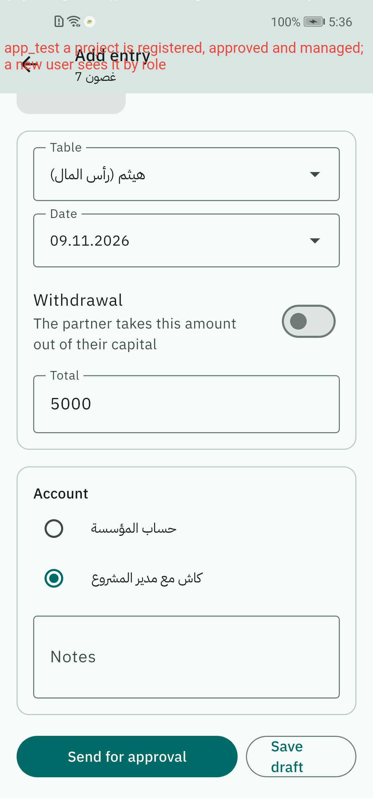

[Documentation](../README.md) › User guide › Reconciliation and capital

# Reconciliation and capital · المطابقة ورأس المال

## English

**What it is for:** checking the accounts against the books, and recording what partners put in and take out.

**Who sees it:** everyone sees the accounts, the difference, the total capital and their own line. Whoever does the project's finance enters these, and they count at once.

**Actual balances**, from the home's buttons, shows what the accounts should hold, what they really held at the last check, and the difference. A difference means an expense not recorded, or bank fees. Under it, each account is listed as on Accounts, without its menu, with what it really held at the last check, or a dash before the first.

**Update** asks what each account really holds, and shows the difference as you type.

**Partners.** The total sits at the top, and each partner shows their balance and share. Tap a partner to see their movements, with the receipt of each.

**A partner's money in or out** is entered from **Add entry**: pick the partner at the end of the table list, under **Partners**. Off, it is money the partner put in; turn on **Withdrawal** for money they took out. Attach the bank receipt when there is one, as for any entry. It waits for approval like an expense, and counts in the capital once approved.

**A partner who pays with their own money.** Enter it from **Add entry** as a contribution to their capital, then pay the expense from the account the money went into. An expense is paid only from an account added in **Accounts**.

To correct any of these, reverse it. What was entered together reverses together.

## العربية

**الغرض:** مطابقة الحسابات مع الدفاتر، وتسجيل ما يضيفه الشركاء وما يسحبونه.

**من يراها:** يرى الجميع الحسابات والفرق وإجمالي رأس المال وسطره هو. ويُدخلها من يتولى مالية المشروع، وتُحتسب فوراً.

**الأرصدة الفعلية**، من أزرار الصفحة الرئيسية، تعرض ما يفترض أن تحويه الحسابات، وما حوته فعلاً عند آخر مطابقة، والفرق. الفرق يعني مصروفاً لم يُسجَّل أو رسوماً بنكية. وتحتها كل حساب كما يظهر في الحسابات، دون قائمته، بما حواه فعلاً عند آخر مطابقة، أو شرطة قبل أولها.

**تحديث** يسأل عما يحويه كل حساب فعلاً، ويعرض الفرق أثناء الكتابة.

**الشركاء.** الإجمالي في الأعلى، ولكل شريك رصيده ونسبته. اضغط الشريك لترى حركاته، ولكلٍّ إيصالها.

**مال الشريك الداخل أو الخارج** يُدخل من **إضافة قيد**: اختر الشريك في آخر قائمة الجداول، تحت **الشركاء**. وهو مال أضافه الشريك، وفعّل **سحب** لمال سحبه. وأرفق الإيصال البنكي إن وُجد، كأي قيد. وينتظر الاعتماد كالمصروف، ولا يُحسب في رأس المال إلا بعد اعتماده.

**شريك يدفع من ماله.** أدخل ذلك من **إضافة قيد** مساهمةً في رأس ماله، ثم ادفع المصروف من الحساب الذي دخله المال. لا يُدفع المصروف إلا من حساب أُضيف في **الحسابات**.

لتصحيح أي منها، اعكسه. وما أُدخل معاً يُعكس معاً.
