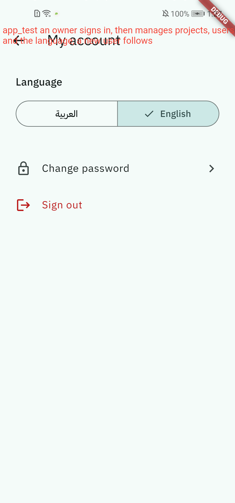
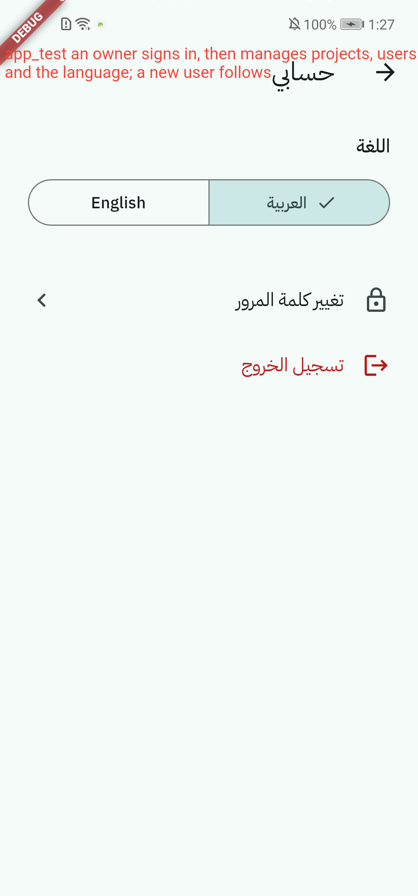

[Documentation](../README.md) › User guide › My account

# My account · حسابي

 

## English

**What it is for:** your own settings: the app's language, changing your password, and signing out.
**Who sees it:** everyone signed in. Open it from [Settings](settings.md), with the settings button at the top of the home screen.

1. Under **Language**, tap **العربية** or **English**. Every screen switches at once: Arabic right to left, English left to right.
2. Tap **Change password** to choose a new password; the back arrow returns here.
3. Tap **Sign out** to leave this phone, then confirm. You will need your username and password to sign in again. Your language stays, and your other phones stay signed in.

The app remembers your language on this phone. Until you choose one, it follows the phone's language, and Arabic when the phone is in neither.

| Message | Meaning |
| --- | --- |
| Switching the language needs a network. | The words of the other language come from REDIX; connect and tap it again. The language stays as it was. |

## العربية

**الغرض:** إعداداتك الخاصة: لغة التطبيق، وتغيير كلمة المرور، وتسجيل الخروج.
**من يراها:** كل من سجّل الدخول. افتحها من [الإعدادات](settings.md)، بزر الإعدادات أعلى الشاشة الرئيسية.

1. تحت **اللغة**، اضغط **العربية** أو **English**، فتتحول كل الشاشات فوراً: العربية من اليمين لليسار، والإنجليزية من اليسار لليمين.
2. اضغط **تغيير كلمة المرور** لاختيار كلمة مرور جديدة؛ وسهم الرجوع يعيدك إلى هنا.
3. اضغط **تسجيل الخروج** لمغادرة هذا الجوال، ثم أكّد. ستحتاج إلى اسم المستخدم وكلمة المرور للدخول مرة أخرى. تبقى لغتك، وتبقى جوالاتك الأخرى مسجّلة.

يحفظ التطبيق لغتك على هذا الجوال. وحتى تختار لغة، يتبع لغة الجوال، والعربية إن لم تكن لغة الجوال إحداهما.

| الرسالة | معناها |
| --- | --- |
| تغيير اللغة يحتاج إلى شبكة. | كلمات اللغة الأخرى تأتي من REDIX؛ اتصل بالشبكة واضغطها مرة أخرى. تبقى اللغة كما كانت. |
