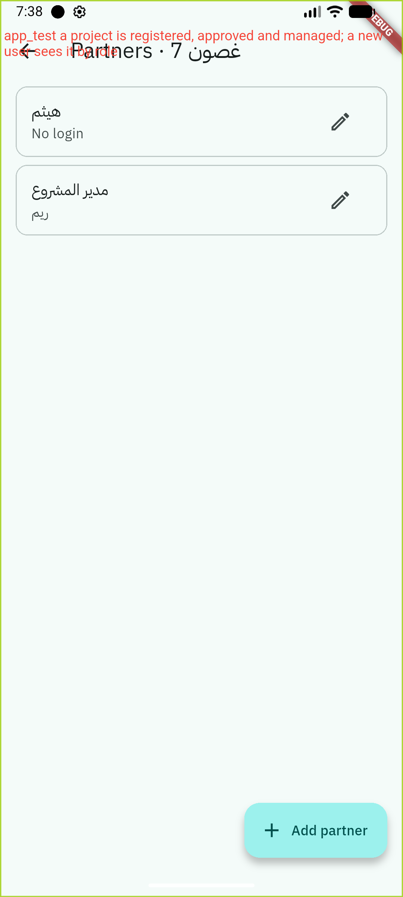
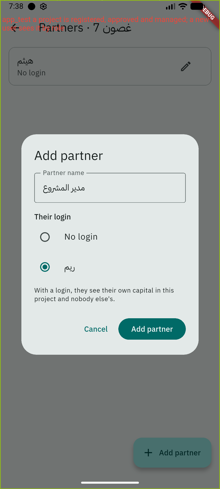

[Documentation](../README.md) › User guide › Partners

# Partners · الشركاء

 

## English

**What it is for:** the partners in this project, and which login belongs to each.
**Who sees it:** the project's manager and whoever does its finance, from **Partners** on the project's home. Only whoever does the finance can change it. It needs a network.

A partner's login decides whose capital is theirs: with a login, a partner sees their own capital in this project and nobody else's. A partner with no login, such as someone who withdrew, stays on the list.

| To | Do this |
| --- | --- |
| Add a partner | Tap **Add partner**, type their name, and choose their login if they have one. |
| Rename a partner, or change their login | Tap the pencil on their row. |

The login must belong to someone in this project, so add them under **Users** first. A partner stays in the project once added.

| Message | Meaning |
| --- | --- |
| Enter a name of 1 to 100 characters. | The name is empty or too long. |
| That login is already another partner's in this project. | Each login is one partner. |
| That person is not in this project. | They left the project; choose someone else. |
| This project is finished, so nothing in it changes. | It was closed; you can still read this screen. |

## العربية

**الغرض:** شركاء هذا المشروع، وحساب الدخول الخاص بكل منهم.
**من يراها:** مدير المشروع ومن يتولى ماليته، من **الشركاء** في رئيسية المشروع. ولا يغيّرها إلا من يتولى المالية. تحتاج إلى اتصال بالشبكة.

حساب دخول الشريك يحدد رأس المال الخاص به: بحساب الدخول يرى الشريك رأس ماله في هذا المشروع دون غيره. والشريك بلا حساب دخول، كمن انسحب، يبقى في القائمة.

| لكي | افعل هذا |
| --- | --- |
| تضيف شريكاً | اضغط **إضافة شريك**، واكتب اسمه، واختر حساب دخوله إن كان له حساب. |
| تعيد تسمية شريك أو تغيّر حساب دخوله | اضغط القلم في صفه. |

يجب أن يكون حساب الدخول لشخص في هذا المشروع، فأضفه أولاً من **المستخدمون**. ويبقى الشريك في المشروع بعد إضافته.

| الرسالة | معناها |
| --- | --- |
| أدخل اسماً من 1 إلى 100 حرف. | الاسم فارغ أو طويل جداً. |
| حساب الدخول هذا لشريك آخر في هذا المشروع. | لكل حساب دخول شريك واحد. |
| هذا الشخص ليس في هذا المشروع. | غادر المشروع، فاختر غيره. |
| هذا المشروع منتهٍ، فلا يتغير فيه شيء. | أُغلق المشروع، وتبقى هذه الشاشة للقراءة. |
