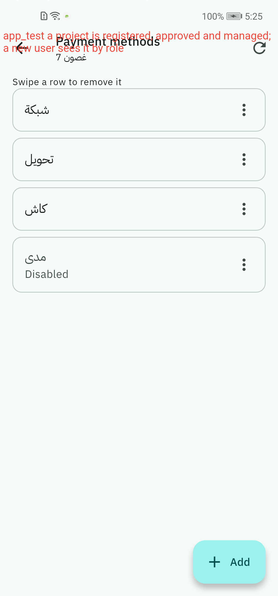

[Documentation](../README.md) › User guide › Payment methods and VAT

# Payment methods and VAT · طرق الدفع والضريبة

## English

**What it is for:** the ways this project pays, and the VAT rate its new entries use.
**Who sees it:** whoever does the project's finance, from **Payment methods and VAT** on the project's home. It needs a network.

A project starts with شبكة, تحويل, كاش and سداد, and a rate of 15%. From then on they are this project's own: changing them touches no other project.

| To | Do this |
| --- | --- |
| Change the VAT rate | Tap the pencil beside it and type the new rate, such as 15 or 7.5. New entries use it; saved entries keep their VAT. |
| Add a payment method | Tap **Add** and type its name. |
| Rename a method | Tap the three dots on its row, then **Rename**. |
| Stop using a method | Tap the three dots, then **Disable**: it disappears from entry and stays on the entries that used it. **Enable** brings it back. Nothing is ever deleted. |

| Message | Meaning |
| --- | --- |
| Enter a rate from 0 to 100, with at most two decimals. | The rate is not a number, or is out of range. |
| Enter a name of 1 to 100 characters. | The name is empty or too long. |
| This project is finished, so nothing in it changes. | It was closed; you can still read this screen. |

## العربية

**الغرض:** طرق الدفع في هذا المشروع، ونسبة ضريبة القيمة المضافة التي تُحسب بها قيوده الجديدة.
**من يراها:** من يتولى مالية المشروع، من **طرق الدفع والضريبة** في رئيسية المشروع. تحتاج إلى اتصال بالشبكة.

يبدأ المشروع بشبكة وتحويل وكاش وسداد، وبنسبة 15%. وبعدها تصبح خاصة بهذا المشروع، فتغييرها لا يمس أي مشروع آخر.

| لكي | افعل هذا |
| --- | --- |
| تغيّر نسبة الضريبة | اضغط القلم بجانبها واكتب النسبة الجديدة، مثل 15 أو 7.5. تُحسب بها القيود الجديدة، وتبقى ضريبة القيود المحفوظة كما هي. |
| تضيف طريقة دفع | اضغط **إضافة** واكتب اسمها. |
| تعيد تسمية طريقة | اضغط النقاط الثلاث في صفها، ثم **إعادة تسمية**. |
| توقف استخدام طريقة | اضغط النقاط الثلاث، ثم **تعطيل**: تختفي من الإدخال وتبقى في القيود التي استخدمتها. و**تفعيل** يعيدها. ولا يُحذف شيء أبداً. |

| الرسالة | معناها |
| --- | --- |
| أدخل نسبة من 0 إلى 100، بخانتين عشريتين على الأكثر. | ما كُتب ليس رقماً، أو خارج المدى. |
| أدخل اسماً من 1 إلى 100 حرف. | الاسم فارغ أو طويل جداً. |
| هذا المشروع منتهٍ، فلا يتغير فيه شيء. | أُغلق المشروع، وتبقى هذه الشاشة للقراءة. |
