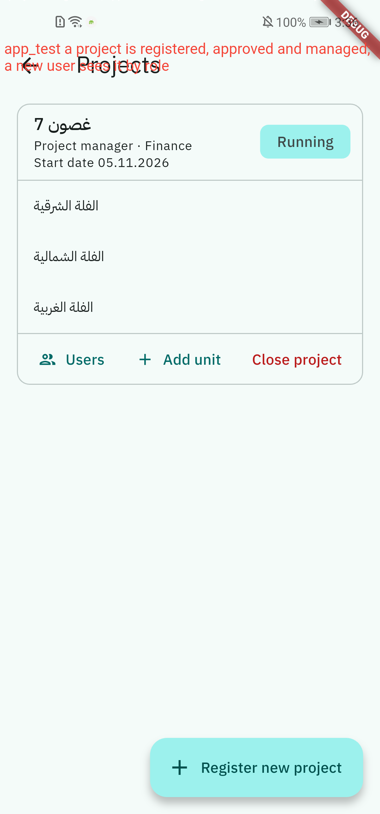
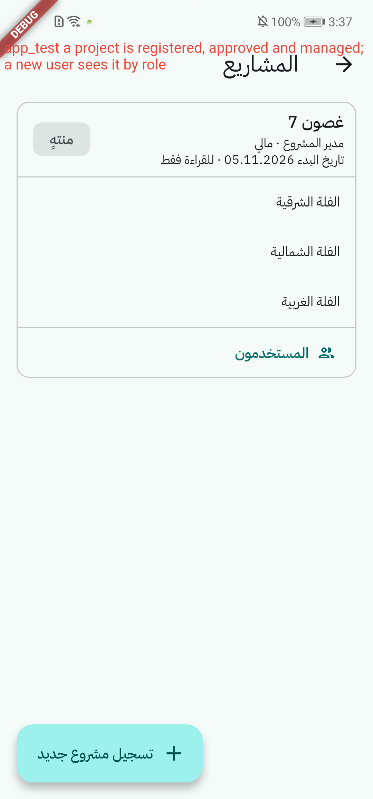

[Documentation](../README.md) › User guide › Projects

# Projects · المشاريع

 
 

## English

**What it is for:** starting a project with its units, and closing it when it is finished.
**Who sees it:** everyone, with the projects they have a role in. Open it from **Settings**, then **Projects**. It needs a network. Under each name are your roles in that project, and its buttons follow them: whoever registers a project becomes its project manager; a financial supervisor adds units and closes it; a project manager opens its **Users**. A project [waits for approval](register-a-project.md) before any of this works.

**Create a project**

1. Tap **New project**.
2. Type the project's name. The start date is today; tap it to choose another.
3. For each unit, type its name and tap **Add unit**. Tap the cross beside a unit to take it off.
4. Tap **Create project**. You return to the list.

**Add a unit later:** on a running project's card, tap **Add unit**, type its name, and tap **Add unit**.

**Close a finished project**

1. On its card, tap **Close project**.
2. Read the question and tap **Close project** to confirm, or **Cancel** to keep it running.

A closed project shows **Finished** and **Read-only**, stays in the list, and cannot be reopened.

| Message | Meaning |
| --- | --- |
| No projects yet. Create the first one. | There are no projects; tap **New project**. |
| Could not load the projects. Check the network and try again. | The phone cannot reach REDIX; tap **Try again**. |
| Enter a name of 1 to 100 characters. | A project or a unit needs a name, no longer than 100 characters. |
| This project is finished, so it cannot change. | Someone closed it meanwhile; the list now shows it. |
| No connection to the server. Try again. | The phone cannot reach REDIX; nothing was changed. |
| The server refused this change. | You may no longer be allowed to do this; ask your project manager. |

## العربية

**الغرض:** بدء مشروع بوحداته، وإغلاقه عند انتهائه.
**من يراها:** الجميع، كلٌّ بالمشاريع التي له دور فيها. افتحها من **الإعدادات** ثم **المشاريع**. تحتاج إلى شبكة. تحت كل اسم أدوارك في المشروع، وأزراره تتبعها: من يسجّل المشروع يصبح مديره، والمشرف المالي يضيف الوحدات ويغلقه، ومدير المشروع يفتح **المستخدمون**. ولا يعمل ذلك قبل [اعتماد المشروع](register-a-project.md).

**إنشاء مشروع**

1. اضغط **مشروع جديد**.
2. اكتب اسم المشروع. تاريخ البدء هو اليوم؛ اضغطه لاختيار غيره.
3. لكل وحدة، اكتب اسمها واضغط **إضافة وحدة**. اضغط العلامة بجانب الوحدة لحذفها.
4. اضغط **إنشاء المشروع**، فتعود إلى القائمة.

**إضافة وحدة لاحقاً:** في بطاقة مشروع جارٍ، اضغط **إضافة وحدة**، واكتب اسمها، ثم اضغط **إضافة وحدة**.

**إغلاق مشروع منتهٍ**

1. في بطاقته، اضغط **إغلاق المشروع**.
2. اقرأ السؤال واضغط **إغلاق المشروع** للتأكيد، أو **إلغاء** ليبقى جارياً.

يظهر المشروع المغلق **منتهٍ** و**للقراءة فقط**، ويبقى في القائمة، ولا يمكن إعادة فتحه.

| الرسالة | معناها |
| --- | --- |
| لا توجد مشاريع بعد. أنشئ أول مشروع. | لا توجد مشاريع؛ اضغط **مشروع جديد**. |
| تعذّر تحميل المشاريع. تحقق من الشبكة وحاول مرة أخرى. | لا يصل الجوال إلى REDIX؛ اضغط **حاول مرة أخرى**. |
| اكتب اسماً من 1 إلى 100 حرف. | يحتاج المشروع أو الوحدة إلى اسم لا يزيد عن 100 حرف. |
| هذا المشروع منتهٍ، فلا يمكن تغييره. | أغلقه شخص آخر في الأثناء؛ والقائمة تظهره الآن. |
| لا يوجد اتصال بالخادم. حاول مرة أخرى. | لا يصل الجوال إلى REDIX؛ لم يتغير شيء. |
| رفض الخادم هذا التغيير. | ربما لم يعد مسموحاً لك بذلك؛ راجع مدير مشروعك. |
