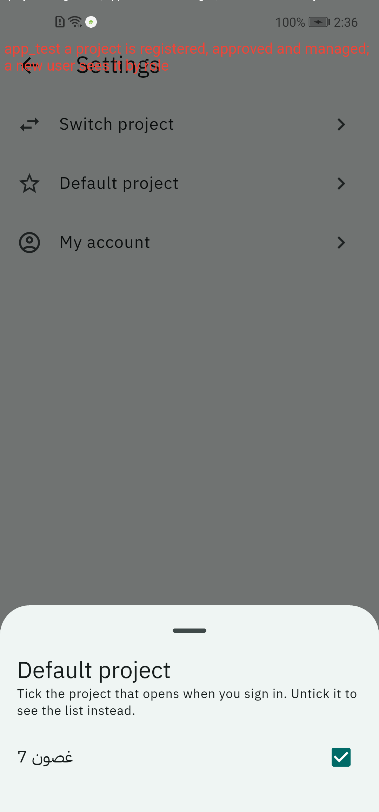
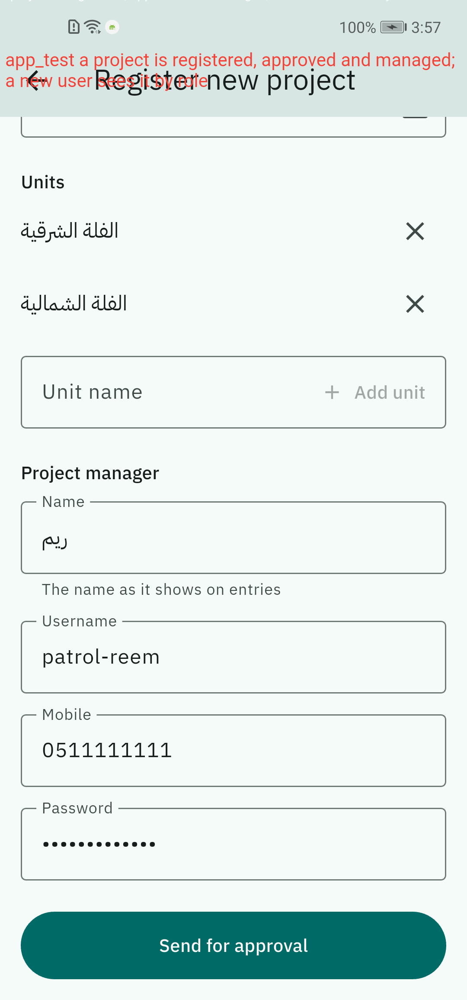
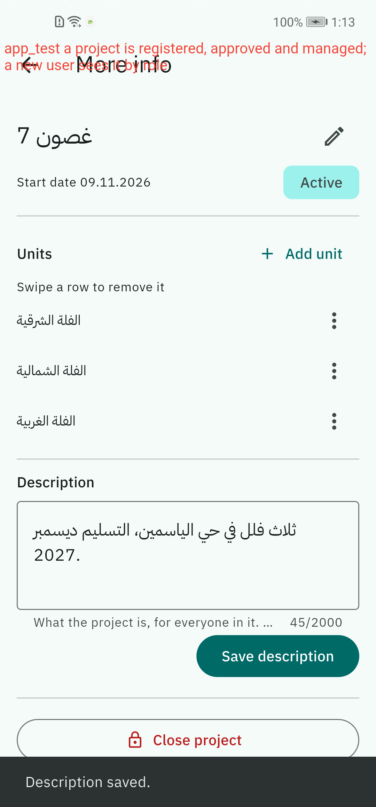
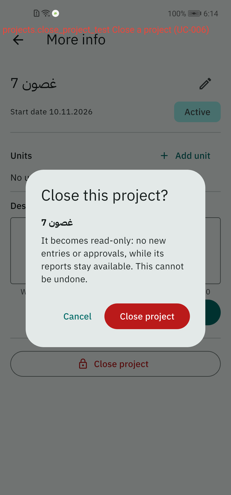

[Documentation](../README.md) › User guide › Projects

# Projects · المشاريع

  
  

## English

**What it is for:** choosing a project, registering a new one with its units and description, reading its own record in More info, and closing one when it is finished.
**Who sees it:** everyone, with the projects they have a role in. It is the first screen after you sign in, and it needs a network. Under each name are your roles in that project, and its [home](home.md) follows them: whoever registers a project becomes its project manager; a financial supervisor adds units and closes it; a project manager opens its **Users**. A project [waits for approval](register-a-project.md) before it opens.

After you sign in, REDIX lists the projects you have access to. Tap one to open it: what you can do there follows your role in that project. To open the same project every time you sign in, tap its star, or open **Settings**, then **Default project**, and tick it. A message says it is now your default. Tap the star again, or untick it, to see the list at sign-in instead. To change project later, open **Settings**, then **Switch project**.

**Register a project**

1. Tap **Register new project**.
2. Type the project's name and, if you like, a short description of it, up to 2,000 characters. The start date is today; tap it to choose another.
3. For each unit, type its name and tap **Add unit**. Swipe a unit's row to take it off.
4. Choose where its [categories and items](categories.md) come from: the default template, or a project you already have. They are copied when the project is approved.
5. Tap **Send for approval**. You return to the list, where it waits for approval.

**More info**

On a project's home, open **More info**. It shows the project's name, start date, status, units and description to everyone in the project. Whoever does the project's finance also changes them there, while the project is active:

- **Rename:** tap the pencil beside the name.
- **Add a unit:** tap **Add unit**, type its name, and tap **Add unit**. To rename a unit, use the menu on its row; to delete it, swipe its row. Entries and contracts belong to the project, not a unit, so any unit can be deleted.
- **Description:** write what the project is, up to 2,000 characters, and tap **Save description**. "Description saved." confirms it. Saving it empty clears it.

**Close a finished project**

1. Open **More info** from the project's home, and tap **Close project** at the bottom.
2. Read the question and tap **Close project** to confirm, or **Cancel** to keep it active.

A closed project shows **Finished · Read-only** on its home, stays in the list, and cannot be reopened. Its More info can still be read.

| Message | Meaning |
| --- | --- |
| No projects yet. | You have no project yet; tap **Register new project**. |
| Could not load the projects. Check the network and try again. | The phone cannot reach REDIX; tap **Try again**. |
| Enter a name of 1 to 100 characters. | A project or a unit needs a name, no longer than 100 characters. |
| Write at most 2,000 characters. | The description is longer than 2,000 characters. |
| This project is finished, so it cannot change. | Someone closed it meanwhile; the list now shows it. |
| No connection to the server. Try again. | The phone cannot reach REDIX; nothing was changed. |
| The server refused this change. | You may no longer be allowed to do this; ask your project manager. |

## العربية

**الغرض:** اختيار مشروع، وتسجيل مشروع جديد بوحداته ووصفه، وقراءة بياناته في معلومات المشروع، وإغلاقه عند انتهائه.
**من يراها:** الجميع، كلٌّ بالمشاريع التي له دور فيها. هي أول شاشة بعد تسجيل الدخول، وتحتاج إلى شبكة. تحت كل اسم أدوارك في المشروع، و[شاشته الرئيسية](home.md) تتبعها: من يسجّل المشروع يصبح مديره، والمشرف المالي يضيف الوحدات ويغلقه، ومدير المشروع يفتح **المستخدمون**. ولا يُفتح المشروع قبل [اعتماده](register-a-project.md).

بعد تسجيل الدخول، يعرض REDIX المشاريع المصرّح لك بها. اضغط أحدها لفتحه: وما يمكنك فعله فيه يتبع دورك في ذلك المشروع. لفتح المشروع نفسه كلما دخلت، اضغط نجمته، أو افتح **الإعدادات** ثم **المشروع الافتراضي** واختره، فتظهر رسالة بأنه صار مشروعك الافتراضي. اضغط النجمة مرة أخرى، أو ألغِ اختياره، لتظهر القائمة عند الدخول. ولتغيير المشروع لاحقاً، افتح **الإعدادات** ثم **تبديل المشروع**.

**تسجيل مشروع**

1. اضغط **تسجيل مشروع جديد**.
2. اكتب اسم المشروع، وإن شئت وصفاً قصيراً له حتى 2000 حرف. تاريخ البدء هو اليوم؛ اضغطه لاختيار غيره.
3. لكل وحدة، اكتب اسمها واضغط **إضافة وحدة**. واسحب سطر الوحدة لحذفها.
4. اضغط **إرسال للاعتماد**، فتعود إلى القائمة، وينتظر فيها الاعتماد.

**معلومات المشروع**

في الشاشة الرئيسية للمشروع، افتح **معلومات المشروع**. تعرض اسم المشروع وتاريخ بدئه وحالته ووحداته ووصفه لكل من في المشروع. ويغيّرها منها من يتولى مالية المشروع، ما دام نشطاً:

- **تعديل الاسم:** اضغط القلم بجانب الاسم.
- **إضافة وحدة:** اضغط **إضافة وحدة**، واكتب اسمها، ثم اضغط **إضافة وحدة**. ولتعديل اسم وحدة استخدم القائمة في سطرها، ولحذفها اسحب سطرها؛ فالقيود والعقود للمشروع لا للوحدة، فتُحذف أي وحدة.
- **الوصف:** اكتب ما هو المشروع، حتى 2000 حرف، واضغط **حفظ الوصف**، فتظهر "تم حفظ الوصف.". وحفظه فارغاً يمسحه.

**إغلاق مشروع منتهٍ**

1. افتح **معلومات المشروع** من الشاشة الرئيسية للمشروع، واضغط **إغلاق المشروع** في الأسفل.
2. اقرأ السؤال واضغط **إغلاق المشروع** للتأكيد، أو **إلغاء** ليبقى نشطاً.

يظهر في الشاشة الرئيسية للمشروع المغلق **منتهٍ · للقراءة فقط**، ويبقى في القائمة، ولا يمكن إعادة فتحه. وتبقى معلومات المشروع متاحة للقراءة.

| الرسالة | معناها |
| --- | --- |
| لا مشاريع بعد. | ليس لديك مشروع بعد؛ اضغط **تسجيل مشروع جديد**. |
| تعذّر تحميل المشاريع. تحقق من الشبكة وحاول مرة أخرى. | لا يصل الجوال إلى REDIX؛ اضغط **حاول مرة أخرى**. |
| اكتب اسماً من 1 إلى 100 حرف. | يحتاج المشروع أو الوحدة إلى اسم لا يزيد عن 100 حرف. |
| اكتب 2000 حرف على الأكثر. | الوصف أطول من 2000 حرف. |
| هذا المشروع منتهٍ، فلا يمكن تغييره. | أغلقه شخص آخر في الأثناء؛ والقائمة تظهره الآن. |
| لا يوجد اتصال بالخادم. حاول مرة أخرى. | لا يصل الجوال إلى REDIX؛ لم يتغير شيء. |
| رفض الخادم هذا التغيير. | ربما لم يعد مسموحاً لك بذلك؛ راجع مدير مشروعك. |
