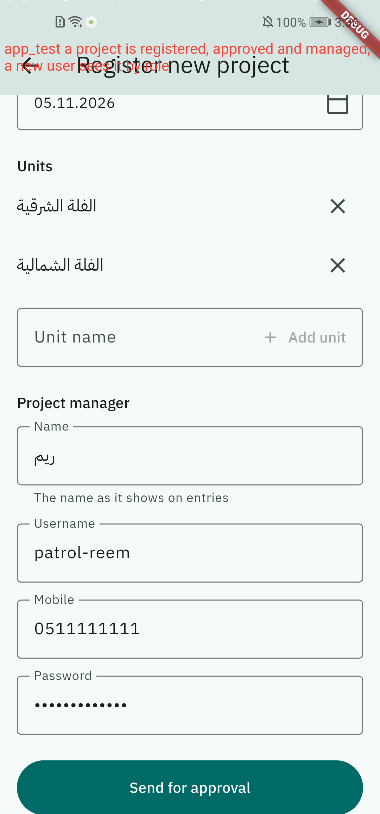
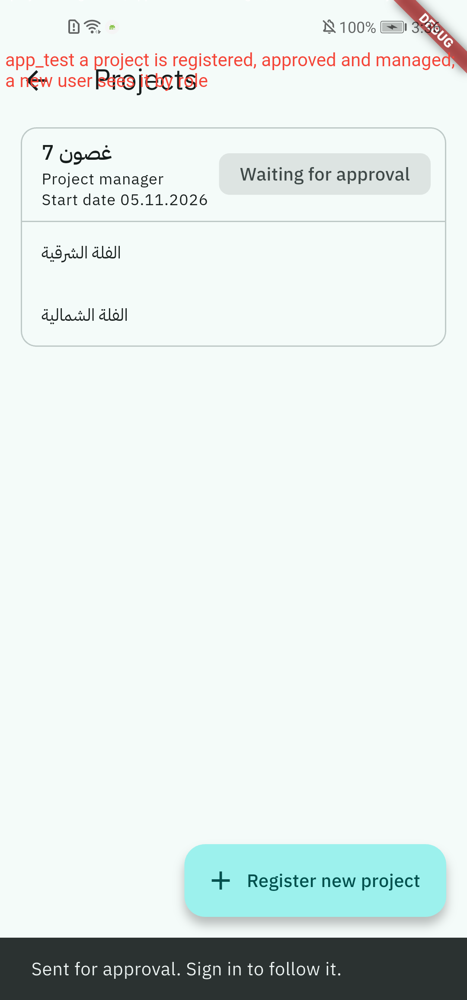
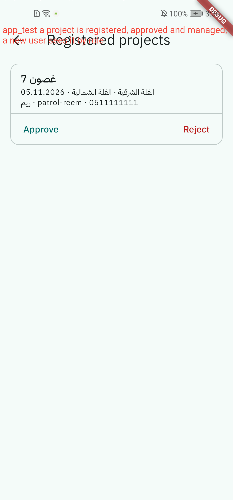

[Documentation](../README.md) › User guide › Register a project

# Register a project · تسجيل مشروع

  

## English

**What it is for:** starting a new project.
**Who sees it:** everyone. It needs a network.

To start a new project, tap **Register new project** on the sign-in page, or on your project list if you already have an account. Type the project and, on the sign-in page, your own details: you will be its project manager. The project waits until the admin approves it. You can sign in and see it waiting; if it is rejected, you see why and can register again.

**The admin** opens **Settings**, then **Registered projects**, sees each project and who registered it, and taps **Approve**, or **Reject** and writes why. This is all the admin can do: the admin does not see inside projects or manage their users.

| Message | Meaning |
| --- | --- |
| This username is taken. If it is yours, sign in and register from your projects. | Someone already has it, perhaps you. |
| Too many tries. Try again later. | Too many registrations from this address. |
| This project was already decided. | Someone else approved or rejected it. |

## العربية

**الغرض:** بدء مشروع جديد.
**من يراها:** الجميع. تحتاج إلى شبكة.

لبدء مشروع جديد، اضغط **تسجيل مشروع جديد** في صفحة الدخول، أو في قائمة مشاريعك إن كان لديك حساب. اكتب بيانات المشروع، وبياناتك أنت في صفحة الدخول: فستكون مدير المشروع. يبقى المشروع بانتظار اعتماد مسؤول النظام. يمكنك الدخول ورؤيته بانتظار الاعتماد؛ وإن رُفض ترى السبب ويمكنك التسجيل من جديد.

**مسؤول النظام** يفتح **الإعدادات** ثم **المشاريع المسجّلة**، فيرى كل مشروع ومن سجّله، ويضغط **اعتماد**، أو **رفض** ويكتب السبب. وليس له غير ذلك: فلا يرى داخل المشاريع ولا يدير مستخدميها.

| الرسالة | معناها |
| --- | --- |
| اسم المستخدم هذا مستخدم. إن كان لك، سجّل الدخول وسجّل المشروع من مشاريعك. | لدى شخص آخر الاسم نفسه، وربما أنت. |
| محاولات كثيرة. حاول مرة أخرى لاحقاً. | تسجيلات كثيرة من هذا العنوان. |
| سبق البت في هذا المشروع. | اعتمده أو رفضه شخص آخر. |
