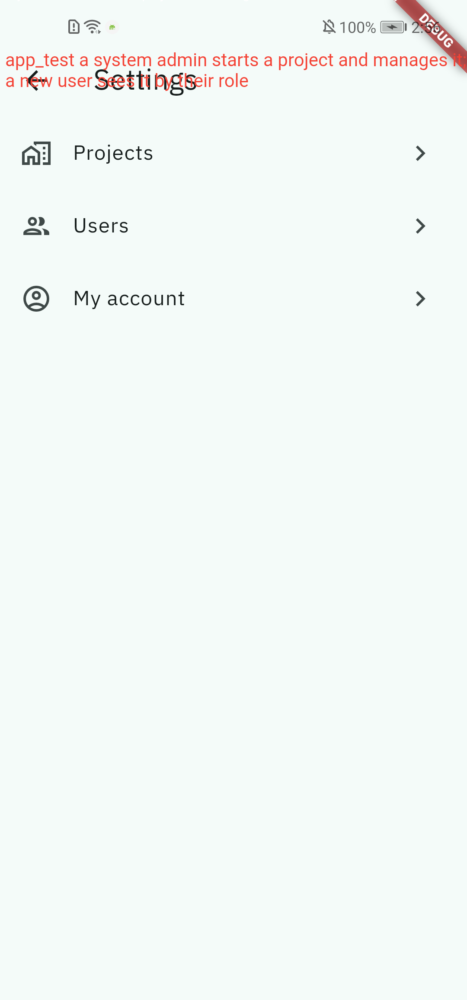

[Documentation](../README.md) › User guide › Settings

# Settings · الإعدادات

## English

**What it is for:** the way into your projects and your account.
**Who sees it:** everyone signed in. Open it with the settings button at the top of the home screen.

| Row | Who sees it | Opens |
| --- | --- | --- |
| Projects | Everyone | [Projects](projects.md) |
| Users | The system admin | [Users](users.md) |
| My account | Everyone | [My account](my-account.md) |

## العربية

**الغرض:** الوصول إلى مشاريعك وحسابك.
**من يراها:** كل من سجّل الدخول. افتحها من زر الإعدادات أعلى الشاشة الرئيسية.

| الصف | من يراه | يفتح |
| --- | --- | --- |
| المشاريع | الجميع | [المشاريع](projects.md) |
| المستخدمون | مسؤول النظام | [المستخدمون](users.md) |
| حسابي | الجميع | [حسابي](my-account.md) |
