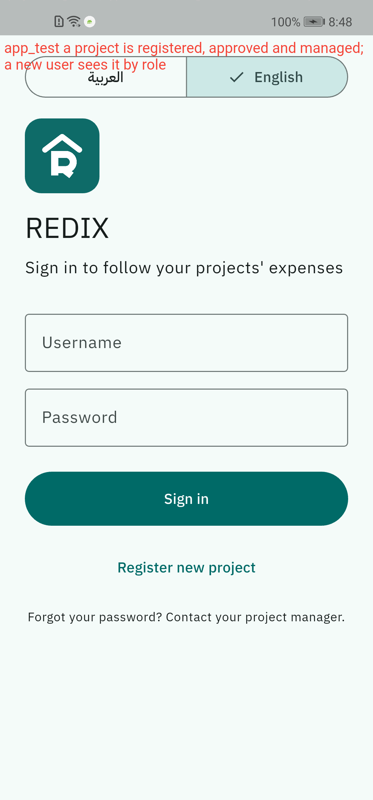

[Documentation](../README.md) › User guide › Sign in

# Sign in · تسجيل الدخول

## English

**What it is for:** getting into REDIX with the username and password the financial supervisor gave you.
**Who sees it:** everyone who is not signed in.

1. Type your username and your password.
2. Tap **Sign in**. You land on your [projects](projects.md), or directly on your default project if you chose that.

You stay signed in on this phone, even without a network, until you are away for 12 hours in a row or your project manager disables your account; then the app asks you to sign in again. With fingerprint or face on, being away does not end it.

If you turned on fingerprint or face in [Settings](settings.md), the app asks for it as it opens. Tap **Use password** on the prompt to type your password instead. After 3 failed tries, or when a new fingerprint or face was added to the phone, only your password works; turn it on again afterwards.

| Message | Meaning |
| --- | --- |
| The username or password is wrong. | Check both; the app never says which one is wrong. |
| Too many wrong tries. Try again later. | Five wrong passwords in a row lock the account for 15 minutes. |
| No connection to the server. Try again. | The phone cannot reach REDIX; check the network. |
| Your session ended. Sign in again. | You were away too long, or your account changed. |

Forgot your password? Tap **Forgot your password?** under **Sign in**: a code goes to your email, and you choose a new password with it. See [Forgot password](forgot-password.md). Your project manager can still set a temporary one for you.

## العربية

**الغرض:** الدخول إلى REDIX باسم المستخدم وكلمة المرور اللذين أعطاك إياهما المشرف المالي.
**من يراها:** كل من لم يسجّل الدخول.

1. اكتب اسم المستخدم وكلمة المرور.
2. اضغط **دخول**، فتنتقل إلى [مشاريعك](projects.md)، أو مباشرة إلى مشروعك الافتراضي إن اخترت ذلك.

تبقى مسجّلاً على هذا الجوال حتى دون شبكة، إلا إذا غبت 12 ساعة متصلة أو عطّل مدير مشروعك حسابك، فيطلب التطبيق تسجيل الدخول من جديد. ومع تفعيل البصمة أو الوجه لا ينهيها الغياب.

إذا فعّلت البصمة أو الوجه في [الإعدادات](settings.md)، يطلبها التطبيق عند فتحه. اضغط **كلمة المرور** في نافذة الطلب لكتابة كلمة المرور بدلاً منها. وبعد 3 محاولات فاشلة، أو عند إضافة بصمة أو وجه جديد إلى الجوال، لا تعمل إلا كلمة المرور؛ ثم فعّلها من جديد.

| الرسالة | معناها |
| --- | --- |
| اسم المستخدم أو كلمة المرور غير صحيحة. | تحقق من الاثنين؛ لا يذكر التطبيق أيهما الخطأ. |
| محاولات خاطئة كثيرة. حاول مرة أخرى لاحقاً. | خمس كلمات مرور خاطئة متتالية تقفل الحساب 15 دقيقة. |
| لا يوجد اتصال بالخادم. حاول مرة أخرى. | لا يصل الجوال إلى REDIX؛ تحقق من الشبكة. |
| انتهت الجلسة. سجّل الدخول مرة أخرى. | غبت طويلاً، أو تغيّر حسابك. |

نسيت كلمة المرور؟ اضغط **نسيت كلمة المرور؟** تحت **دخول**: يصل رمز إلى بريدك، وتختار به كلمة مرور جديدة. انظر [نسيت كلمة المرور](forgot-password.md). ويبقى بوسع مدير مشروعك أن يضع لك كلمة مؤقتة.
