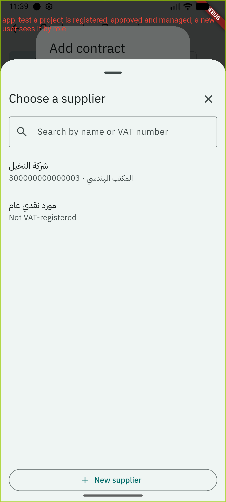
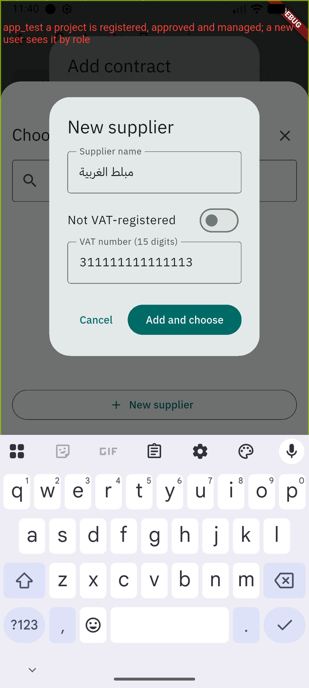

[Documentation](../README.md) › User guide › Choosing a supplier

# Choosing a supplier · اختيار المورد

 

## English

**What it is for:** naming a supplier from the project's list, so its VAT number comes with it and the same supplier is never typed two ways.
**Who sees it:** whoever enters something that needs a supplier, such as a purchase expense or a contract's contractor. It needs a network.

| To | Do this |
| --- | --- |
| Find a supplier | Those you used most come first, under **Most used**. Otherwise type three letters of its name, or part of its VAT number. |
| Choose it | Tap its row. |
| Leave without choosing | Tap the X. |
| Add a supplier that is not on the list | Tap **New supplier**. What you typed in the search is filled in. Add its name and VAT number, or turn on **Not VAT-registered**, then tap **Add and choose**. |

A disabled supplier is not offered. If you see **No supplier matches.**, check the spelling: أ and ا count as different letters.

Someone who does not keep the project's settings adds a supplier **Pending approval**: it is approved with the first expense on it, and until then only they and whoever does the finance can choose it.

| Message | Meaning |
| --- | --- |
| A VAT number is 15 digits, starting and ending with 3. | The number is wrong, or was left empty. |
| This VAT number already belongs to another supplier. | The line under the number names that supplier. Tap **Use this supplier** to go on with it. A disabled supplier cannot be chosen; ask whoever does the finance to enable it. |

## العربية

**الغرض:** اختيار مورد من قائمة المشروع، فيأتي رقمه الضريبي معه ولا يُكتب المورد نفسه بطريقتين.
**من يراها:** من يدخل ما يحتاج إلى مورد، مثل مصروف شراء أو مقاول العقد. تحتاج إلى اتصال بالشبكة.

| لكي | افعل هذا |
| --- | --- |
| تجد مورداً | يأتي الأكثر استخداماً لديك أولاً، تحت **الأكثر استخداماً**. وإلا فاكتب ثلاثة أحرف من اسمه، أو جزءاً من رقمه الضريبي. |
| تختاره | اضغط صفه. |
| تخرج دون اختيار | اضغط علامة الإغلاق. |
| تضيف مورداً ليس في القائمة | اضغط **مورد جديد**. ويُعبّأ ما كتبته في البحث. أضف اسمه ورقمه الضريبي، أو فعّل **غير مسجل بالضريبة**، ثم اضغط **إضافة واختيار**. |

المورد المعطّل لا يظهر هنا. وإن ظهرت **لا يوجد مورد مطابق.** فراجع الإملاء: فالحرفان أ وا يُعدّان مختلفين.

من لا يتولى إعدادات المشروع يضيف المورد **بانتظار الاعتماد**: فيُعتمد مع أول مصروف عليه، ولا يختاره حتى ذلك الحين إلا هو ومن يتولى المالية.

| الرسالة | معناها |
| --- | --- |
| الرقم الضريبي 15 رقماً، يبدأ بالرقم 3 وينتهي به. | الرقم خاطئ أو تُرك فارغاً. |
| هذا الرقم الضريبي لمورد آخر. | يظهر اسم ذلك المورد تحت الرقم. اضغط **استخدام هذا المورد** للمتابعة به. ولا يمكن اختيار مورد معطّل، فاطلب ممن يتولى المالية تفعيله. |
