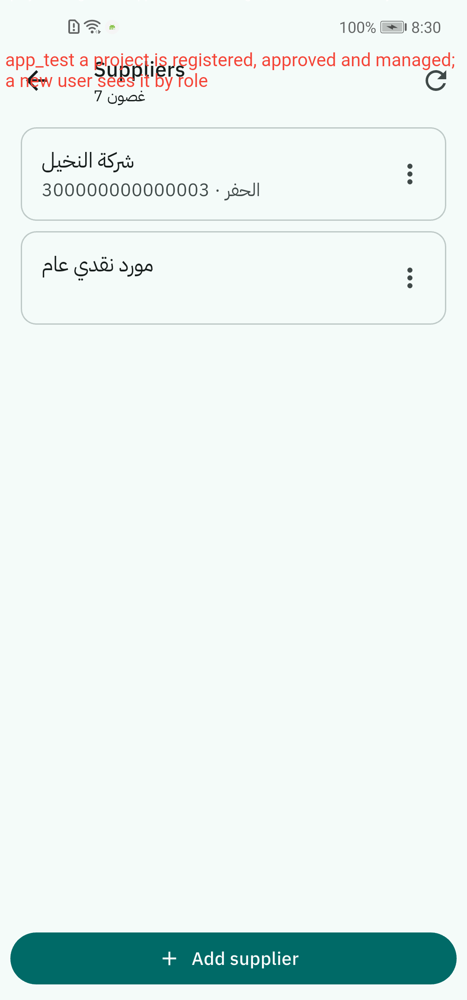
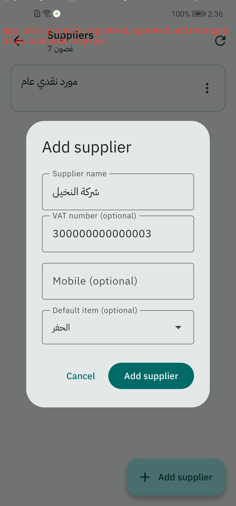

[Documentation](../README.md) › User guide › Suppliers

# Suppliers · الموردون

 

## English

**What it is for:** the list of this project's suppliers. A purchase names a supplier from this list, never a name typed by hand.
**Who sees it:** everyone in the project, from **Suppliers** on the project's home. Only whoever does the finance can change it. It needs a network.

The list starts with مورد نقدي عام, the general cash supplier, for expenses with no supplier.

| To | Do this |
| --- | --- |
| Add a supplier | Tap **Add supplier**, type its name and VAT number, and add its mobile and default item if you know them. |
| Add a supplier with no VAT number | Turn on **Not VAT-registered**. Its invoices stay out of the VAT statement. |
| Change a supplier | Open the menu on its row and tap **Edit supplier**. |
| Stop using a supplier | Open the menu on its row and tap **Disable**. It disappears from entry and stays in the reports. Nothing is ever deleted. |

A supplier marked **Pending approval** was added from the field, and is approved with the first expense on it.

| Message | Meaning |
| --- | --- |
| Enter a name of 1 to 100 characters. | The name is empty or too long. |
| A VAT number is 15 digits, starting and ending with 3. | The number is wrong, or was left empty. |
| This VAT number already belongs to another supplier. | The line under the number names that supplier. It may be a disabled one. |
| Enter a mobile of up to 20 characters. | The mobile is too long. |
| This project is finished, so nothing in it changes. | It was closed; you can still read this screen. |

## العربية

**الغرض:** قائمة موردي هذا المشروع. يختار مصروف الشراء مورداً من هذه القائمة، ولا يُكتب اسم المورد يدوياً.
**من يراها:** كل من في المشروع، من **الموردون** في رئيسية المشروع. ولا يغيّرها إلا من يتولى المالية. تحتاج إلى اتصال بالشبكة.

تبدأ القائمة بالمورد النقدي العام «مورد نقدي عام»، للمصروفات التي لا مورد لها.

| لكي | افعل هذا |
| --- | --- |
| تضيف مورداً | اضغط **إضافة مورد**، واكتب اسمه ورقمه الضريبي، وأضف جواله وبنده الافتراضي إن عرفتهما. |
| تضيف مورداً بلا رقم ضريبي | فعّل **غير مسجل بالضريبة**. ولا تدخل فواتيره كشف الضريبة. |
| تغيّر بيانات مورد | افتح القائمة في صفه واضغط **تعديل المورد**. |
| توقف استخدام مورد | افتح القائمة في صفه واضغط **تعطيل**. يختفي من الإدخال ويبقى في التقارير، ولا يُحذف شيء أبداً. |

المورد المعلَّم **بانتظار الاعتماد** أضافه المشرف الميداني، ويُعتمد مع أول مصروف عليه.

| الرسالة | معناها |
| --- | --- |
| أدخل اسماً من 1 إلى 100 حرف. | الاسم فارغ أو طويل جداً. |
| الرقم الضريبي 15 رقماً، يبدأ بالرقم 3 وينتهي به. | الرقم خاطئ أو تُرك فارغاً. |
| هذا الرقم الضريبي لمورد آخر. | يظهر اسم ذلك المورد تحت الرقم، وقد يكون مورداً معطّلاً. |
| اكتب رقم جوال من 20 حرفاً على الأكثر. | الجوال طويل جداً. |
| هذا المشروع منتهٍ، فلا يتغير فيه شيء. | أُغلق المشروع، وتبقى هذه الشاشة للقراءة. |
