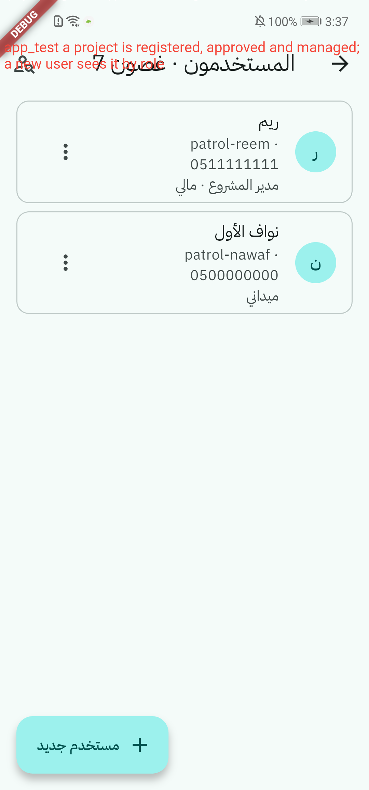
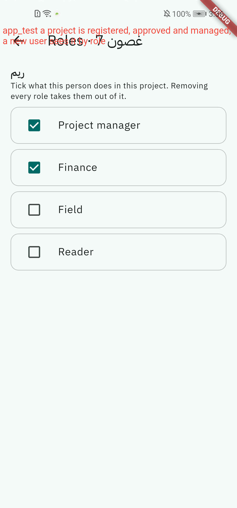

[Documentation](../README.md) › User guide › Users

# Users · المستخدمون

 
 

## English

**What it is for:** adding the people of a project, giving their roles, and looking after their accounts.
**Who sees it:** each project's project manager, from **Users** on the project's card. It needs a network.

Each project has its own project manager, who manages its users and roles. Open **Users** on the project's card. Add a new user, or add someone who already has a login by their exact username. To change what someone does, open their menu, choose **Roles** and tick what applies; someone can hold more than one. A project needs at least one project manager, and a manager changes the project itself only if also given Finance. If a person also works in a project you do not manage, you cannot reset their password or disable them, but you can take their roles here. If a project's only manager forgets their password, nobody in the app can reset it, so keep a second manager.

**Add a user**

1. Tap **New user**.
2. Type their name, as it should show on entries, a username, and their mobile if you have it.
3. Type a temporary password of at least 8 characters.
4. Tap **Add user**, then give them their username and temporary password. At their first sign-in, the app makes them choose their own.

**Change what someone does:** tap the three dots on their row, then **Roles**, and tick what applies. It is saved at once.

**Look after a user:** tap the three dots on their row.

| Choice | What it does |
| --- | --- |
| Edit | Corrects their name and mobile. A username never changes. |
| Roles | Says what they do in this project, as above. |
| Reset password | For a forgotten password. Type a new temporary one and pass it on. They are signed out, and choose their own at their next sign-in. |
| Disable | They are signed out at their next action and cannot sign in. They stay in the list, and their entries are kept. |
| Enable | Lets a disabled user sign in again. |

| Message | Meaning |
| --- | --- |
| This username is taken. Choose another. | Someone already has it. |
| Enter a name of 1 to 100 characters. | The name is empty or too long. |
| Enter a username of 1 to 50 characters. | The username is empty or too long. |
| Enter a mobile of up to 20 characters. | The mobile is too long. |
| Use at least 8 characters. | The temporary password is too short. |
| A project needs at least one project manager. | Make someone else a manager first. |
| This person also works in another project, so this cannot be changed here. | A login shared with a project you do not manage cannot be changed from yours. |
| No user has this username. | Check the exact username with them. |
| Could not load the users. Check the network and try again. | The phone cannot reach REDIX; tap **Try again**. |
| No connection to the server. Try again. | The phone cannot reach REDIX; nothing was changed. |
| The server refused this change. | You may no longer be allowed to do this. |

## العربية

**الغرض:** إنشاء حسابات مستخدمي REDIX والعناية بها.
**من يراها:** مدير كل مشروع، من **المستخدمون** في بطاقة المشروع. تحتاج إلى شبكة.

لكل مشروع مدير مشروع خاص به يدير مستخدميه وأدوارهم. افتح **المستخدمون** من بطاقة المشروع. أضف مستخدماً جديداً، أو من له حساب باسم مستخدمه بالضبط. لتغيير ما يقوم به شخص، افتح قائمته واختر **الأدوار** وحدد ما ينطبق؛ ويمكن أن يجمع أكثر من دور. يحتاج المشروع إلى مدير مشروع واحد على الأقل، ولا يغيّر المدير المشروع نفسه إلا إذا أُسند إليه دور «مالي». وإذا كان الشخص يعمل في مشروع لا تديره، فلا يمكنك إعادة تعيين كلمة مروره أو تعطيله، لكن يمكنك إلغاء أدواره هنا. وإذا نسي مدير المشروع الوحيد كلمة مروره فلا أحد في التطبيق يستطيع إعادة تعيينها، فاحرص على مدير ثانٍ.

**إضافة مستخدم**

1. اضغط **مستخدم جديد**.
2. اكتب اسمه كما يظهر في القيود، واسم مستخدم، وجواله إن كان لديك.
3. اكتب كلمة مرور مؤقتة من 8 أحرف على الأقل.
4. اضغط **إضافة المستخدم**، ثم أعطه اسم المستخدم وكلمة المرور المؤقتة. عند أول دخول، يطلب منه التطبيق اختيار كلمة مروره.

**لتغيير ما يقوم به شخص:** اضغط النقاط الثلاث في صفه، ثم **الأدوار**، وحدد ما ينطبق. يُحفظ فوراً.

**العناية بمستخدم:** اضغط النقاط الثلاث في صفه.

| الخيار | ماذا يفعل |
| --- | --- |
| تعديل | يصحح اسمه وجواله. اسم المستخدم لا يتغير. |
| الأدوار | يحدد ما يقوم به في هذا المشروع، كما سبق. |
| إعادة تعيين كلمة المرور | عند نسيان كلمة المرور. اكتب كلمة مؤقتة جديدة وأعطه إياها. يُسجَّل خروجه، ويختار كلمة مروره عند دخوله التالي. |
| تعطيل | يُسجَّل خروجه عند أول إجراء تالٍ ولا يستطيع الدخول. يبقى في القائمة، وتبقى قيوده. |
| تفعيل | يسمح لمستخدم معطّل بالدخول مرة أخرى. |

| الرسالة | معناها |
| --- | --- |
| اسم المستخدم هذا مستخدم. اختر غيره. | لدى شخص آخر الاسم نفسه. |
| اكتب اسماً من 1 إلى 100 حرف. | الاسم فارغ أو طويل. |
| اكتب اسم مستخدم من 1 إلى 50 حرفاً. | اسم المستخدم فارغ أو طويل. |
| اكتب رقم جوال من 20 حرفاً على الأكثر. | رقم الجوال طويل. |
| استخدم 8 أحرف على الأقل. | كلمة المرور المؤقتة قصيرة. |
| يحتاج المشروع إلى مدير مشروع واحد على الأقل. | اجعل شخصاً آخر مديراً أولاً. |
| يعمل هذا الشخص في مشروع آخر أيضاً، لذا لا يمكن تغيير ذلك من هنا. | لا يمكن تغيير حساب مشترك مع مشروع لا تديره من مشروعك. |
| لا يوجد مستخدم بهذا الاسم. | تأكد منه من اسم المستخدم بالضبط. |
| تعذّر تحميل المستخدمين. تحقق من الشبكة وحاول مرة أخرى. | لا يصل الجوال إلى REDIX؛ اضغط **حاول مرة أخرى**. |
| لا يوجد اتصال بالخادم. حاول مرة أخرى. | لا يصل الجوال إلى REDIX؛ لم يتغير شيء. |
| رفض الخادم هذا التغيير. | ربما لم يعد مسموحاً لك بذلك. |
