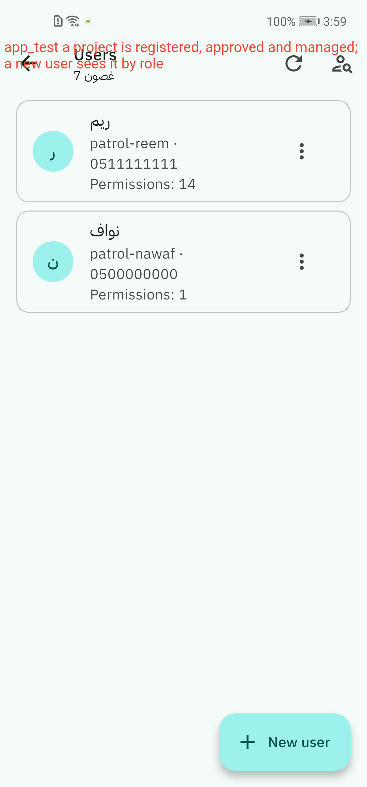
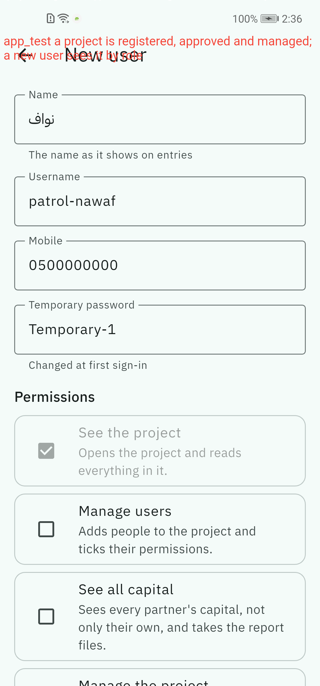
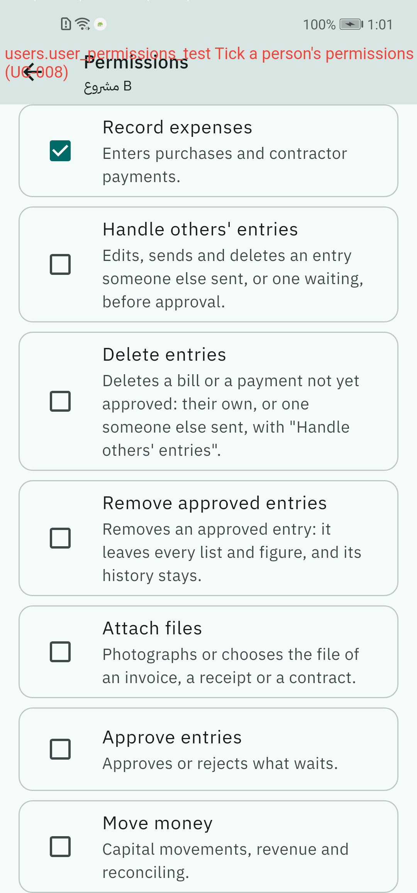

[Documentation](../README.md) › User guide › Users

# Users · المستخدمون

 
 

## English

**What it is for:** adding the people of a project, giving their roles, and looking after their accounts.
**Who sees it:** each project's project manager, from **Users** on the project's card. It needs a network.

Each project has its own project manager, who manages its users. Open **Users** from the project's home. Add a new user, or add someone who already has a login by their exact username. A **Role name**, such as Project manager, is free text typed for each person in each project: it shows beside their username in the list, under the project's name on their home and beside their username in Settings. It is a label only; what they may do is their permissions. To change what someone may do, open their menu, choose **Permissions** and tick each permission they need; there are no roles. A project needs at least one person who manages its users. If a person also works in a project you do not manage, you cannot reset their password, but you can disable them in yours and untick their permissions here. Anyone with an email, a project's only manager included, can also reset a forgotten password themselves from the sign-in screen ([Forgot password](forgot-password.md)); so type each person's email.

**Add a user**

1. Tap **New user**.
2. Type their name, as it should show on entries, a username, their mobile if you have it, and their email, which is required: a forgotten password's code goes to it.
3. Type a temporary password of at least 8 characters.
4. Tap **Add user**, then give them their username and temporary password. At their first sign-in, the app makes them choose their own.

**Change what someone may do:** tap the three dots on their row, then **Permissions**, and tick each one they need. It is saved at once. Unticking **See the project** takes them out of the project.

**Look after a user:** tap the three dots on their row.

| Choice | What it does |
| --- | --- |
| Edit | Corrects their name, mobile and email, and their role name in this project. A username never changes. |
| Permissions | Says what they may do in this project, as above. |
| Reset password | For a forgotten password. Type a new temporary one and pass it on. They are signed out, and choose their own at their next sign-in. |
| Disable | They can no longer open this project, and only this one: their project list shows it gray, saying **Your account is inactive in this project.**, and if they have it open, the list replaces it when they come back from one of its screens, when the app opens or comes back to the screen, or within 15 minutes. They still sign in, stay in this list marked **Disabled**, and keep their permissions and entries here. |
| Enable | They open this project again, with their permissions as before. |

| Message | Meaning |
| --- | --- |
| This username is taken. Choose another. | Someone already has it. |
| The email is not valid. | Type one whole address, such as name@example.com. |
| This email belongs to another account. | Each email is one person's; use theirs. |
| Enter a name of 1 to 100 characters. | The name is empty or too long. |
| Enter a username of 1 to 50 characters. | The username is empty or too long. |
| Enter a mobile of up to 20 characters. | The mobile is too long. |
| Use at least 8 characters. | The temporary password is too short. |
| A project needs at least one project manager. | Make someone else a manager first. |
| This person also works in another project, so this cannot be changed here. | A login shared with a project you do not manage cannot be changed from yours. |
| No user has this username. | Check the exact username with them. |
| Could not load the users. Check the network and try again. | The phone cannot reach REDIX; tap **Try again**. |
| No connection to the server. Try again. | The phone cannot reach REDIX; nothing was changed. |
| The server refused this change. | You may no longer be allowed to do this. |

## العربية

**الغرض:** إنشاء حسابات مستخدمي REDIX والعناية بها.
**من يراها:** مدير كل مشروع، من **المستخدمون** في بطاقة المشروع. تحتاج إلى شبكة.

لكل مشروع مدير مشروع خاص به يدير مستخدميه. افتح **المستخدمون** من الشاشة الرئيسية للمشروع. أضف مستخدماً جديداً، أو من له حساب باسم مستخدمه بالضبط. و**المسمى الوظيفي**، مثل مدير المشروع، نص حر يُكتب لكل شخص في كل مشروع: يظهر بجانب اسم المستخدم في القائمة، وتحت اسم المشروع في شاشته الرئيسية، وبجانب اسم المستخدم في الإعدادات. وهو تسمية فقط؛ وما يستطيعه هو صلاحياته. لتغيير ما يستطيعه شخص، افتح قائمته واختر **الصلاحيات** وحدد كل صلاحية يحتاجها؛ فلا أدوار. ويحتاج المشروع إلى شخص واحد على الأقل يدير مستخدميه. وإذا كان الشخص يعمل في مشروع لا تديره، فلا يمكنك إعادة تعيين كلمة مروره، لكن يمكنك تعطيله في مشروعك وإلغاء صلاحياته هنا. ويستطيع كل من له بريد، ومنهم مدير المشروع الوحيد، أن يعيد تعيين كلمة مروره بنفسه من شاشة تسجيل الدخول ([نسيت كلمة المرور](forgot-password.md))؛ فاكتب بريد كل شخص.

**إضافة مستخدم**

1. اضغط **مستخدم جديد**.
2. اكتب اسمه كما يظهر في القيود، واسم مستخدم، وجواله إن كان لديك، وبريده، وهو مطلوب: إليه يصل رمز كلمة المرور المنسية.
3. اكتب كلمة مرور مؤقتة من 8 أحرف على الأقل.
4. اضغط **إضافة المستخدم**، ثم أعطه اسم المستخدم وكلمة المرور المؤقتة. عند أول دخول، يطلب منه التطبيق اختيار كلمة مروره.

**لتغيير ما يستطيعه شخص:** اضغط النقاط الثلاث في صفه، ثم **الصلاحيات**، وحدد كل صلاحية يحتاجها. يُحفظ فوراً. وإلغاء **يرى المشروع** يُخرجه من المشروع.

**العناية بمستخدم:** اضغط النقاط الثلاث في صفه.

| الخيار | ماذا يفعل |
| --- | --- |
| تعديل | يصحح اسمه وجواله وبريده، ومسماه الوظيفي في هذا المشروع. اسم المستخدم لا يتغير. |
| الصلاحيات | يحدد ما يستطيعه في هذا المشروع، كما سبق. |
| إعادة تعيين كلمة المرور | عند نسيان كلمة المرور. اكتب كلمة مؤقتة جديدة وأعطه إياها. يُسجَّل خروجه، ويختار كلمة مروره عند دخوله التالي. |
| تعطيل | لا يستطيع فتح هذا المشروع وحده: تظهره قائمة مشاريعه رمادياً بعبارة **حسابك غير مفعّل في هذا المشروع.**، وإن كان مفتوحاً لديه تحل القائمة محله عند عودته من إحدى شاشاته، أو عند فتح التطبيق أو عودته إلى الشاشة، أو خلال 15 دقيقة. ويبقى يسجّل الدخول، ويبقى في هذه القائمة **معطّل**، وتبقى صلاحياته وقيوده فيه. |
| تفعيل | يفتح هذا المشروع مرة أخرى، بصلاحياته كما كانت. |

| الرسالة | معناها |
| --- | --- |
| اسم المستخدم هذا مستخدم. اختر غيره. | لدى شخص آخر الاسم نفسه. |
| البريد غير صحيح. | اكتب عنوانًا كاملاً، مثل name@example.com. |
| هذا البريد لحساب آخر. | لكل بريد شخص واحد؛ استخدم بريده هو. |
| اكتب اسماً من 1 إلى 100 حرف. | الاسم فارغ أو طويل. |
| اكتب اسم مستخدم من 1 إلى 50 حرفاً. | اسم المستخدم فارغ أو طويل. |
| اكتب رقم جوال من 20 حرفاً على الأكثر. | رقم الجوال طويل. |
| استخدم 8 أحرف على الأقل. | كلمة المرور المؤقتة قصيرة. |
| يحتاج المشروع إلى مدير مشروع واحد على الأقل. | اجعل شخصاً آخر مديراً أولاً. |
| يعمل هذا الشخص في مشروع آخر أيضاً، لذا لا يمكن تغيير ذلك من هنا. | لا يمكن تغيير حساب مشترك مع مشروع لا تديره من مشروعك. |
| لا يوجد مستخدم بهذا الاسم. | تأكد منه من اسم المستخدم بالضبط. |
| تعذّر تحميل المستخدمين. تحقق من الشبكة وحاول مرة أخرى. | لا يصل الجوال إلى REDIX؛ اضغط **حاول مرة أخرى**. |
| لا يوجد اتصال بالخادم. حاول مرة أخرى. | لا يصل الجوال إلى REDIX؛ لم يتغير شيء. |
| رفض الخادم هذا التغيير. | ربما لم يعد مسموحاً لك بذلك. |
